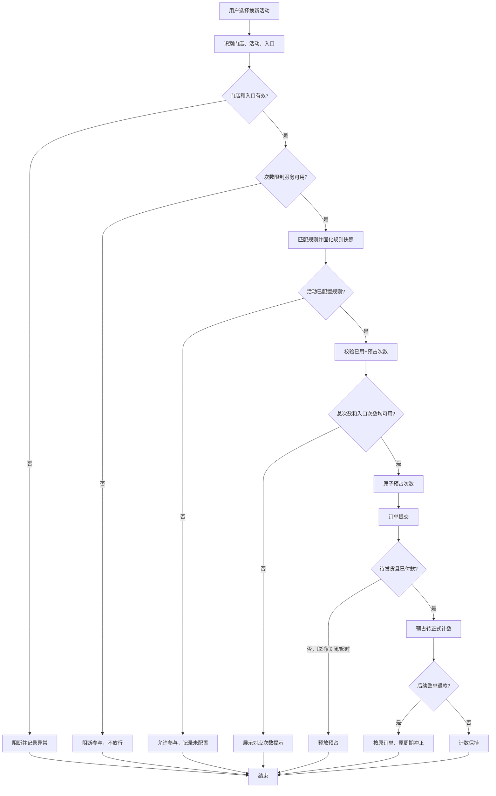

# 门店换新活动参与次数限制 PRD

> 版本：v0.4<br>
> 状态：草案，待业务与技术评审<br>
> 更新日期：2026-11-10

## 1. 文档信息

| 字段 | 内容 |
|---|---|
| 需求 ID | REQ-20261110-001 |
| 需求名称 | 门店换新活动参与次数限制 |
| 产品负责人 | 待定 |
| 关联系统 | 换新活动配置、柜机、App、订单中心、退款中心、运营后台 |
| 关联材料 | 本 PRD、配置菜单交互原型；后续补充接口规格和测试用例 |

## 2. 背景与目标

### 2.1 背景

当前一个门店可以配置多个换新活动，并同时存在柜机和 App 两个活动入口。现有活动配置主要按活动维度管理，缺少统一的门店参与次数控制，容易出现以下问题：

- 同一门店的不同活动分别参与，门店总参与量无法统一控制。
- 柜机和 App 两个入口可能各自绕过限制，无法形成门店级硬上限。
- 门店数量较多且持续新增，逐门店维护配置的成本高，也容易漏配。
- 成交、退款和活动切换后，次数缺少统一、可追溯的计数口径。

### 2.2 本期目标

1. 以“门店 × 规则 × 周期”为单位统计换新活动参与次数，限制门店整体参与量。
2. 配置规则不绑定具体门店，通过活动 ID 集合确定适用范围；规则自动覆盖所有参与这些活动的门店，包括新增门店。
3. 支持门店总次数、柜机入口次数、App 入口次数三类次数，支持单日、单月周期。
4. 仅当订单状态为“待发货”且付款状态为“已付款”时，每笔订单计 1 次；整单退款成功时按原订单还原 1 次。
5. 通过原子预占和幂等处理，避免并发成交突破次数限制或重复计数。

### 2.3 成功指标

| 指标 | 目标 | 测量方式 |
|---|---|---|
| 规则覆盖 | 命中规则的活动订单 100% 经过次数校验 | 订单侧校验日志 |
| 超限成交 | 同一规则、同一门店、同一周期内 0 笔超限成交 | 计数流水与订单对账 |
| 新门店覆盖 | 新门店参与规则内活动时无需补配置即可生效 | 新门店首单校验记录 |
| 退款冲正 | 整单退款 100% 可追溯，重复回调 0 次重复返还 | 退款流水与计数流水对账 |

> 当前没有基线数据，具体业务目标值待补充；上表先作为能力与质量目标。

## 3. 本期范围

### 3.1 本期包含

- 不绑定门店的次数限制规则管理。
- 活动 ID 集合配置：每条规则必须配置至少 1 个活动 ID，不支持全局不限活动的规则。
- 同一活动 ID 在所有配置中只能归属一条规则，不允许重复配置。
- 门店级门店日总数量、门店月总数量限制。
- 柜机、App 分入口的门店日次数、门店月次数限制。
- 活动订单提交时的次数校验和预占。
- 订单状态与付款状态联合判定成交、成交计数、整单退款冲正和冲正流水。
- 规则启停、变更审计、用量查询和异常记录。
- 规则批量导入：支持 CSV 整批校验、预览和创建。
- 配置操作日志：记录创建、编辑、启停和批量导入的变更前后值。
- 新门店自动纳入；新活动由运营手工加入规则，不会自动套用其他规则。
- 配置菜单、规则列表、新建/编辑、启停、批量导入、活动占用校验、操作日志和交互反馈。

### 3.2 本期不包含

- 按具体门店维护白名单、黑名单或单独次数。
- 按顾客、手机号或会员账户限制活动参与次数。
- 活动预算、补贴库存、券库存和奖品库存控制。
- 改变活动补贴、回收价或结算价的计算逻辑。
- 一单多机；业务已明确一单一机，每单固定计 1 次。
- 对功能上线前已成交订单进行历史补计。
- “全店总次数 + 活动集合子次数限制”的多层嵌套规则；本期采用活动集合归属单一规则的方式。

## 4. 术语与口径

| 术语 | 定义 |
|---|---|
| 换新活动 | 业务上可参与以旧换新的活动；具体活动类型和活动 ID 以活动中心为准 |
| 门店 | 参与换新活动的门店主体，按门店 ID 唯一识别 |
| 入口 | 本期限定为柜机、App 两类；订单必须能识别实际成交入口 |
| 规则 | 一组活动 ID 集合及其对应的门店参与次数上限 |
| 活动集合 | 规则覆盖的活动 ID 列表；每条规则至少包含 1 个活动，不支持为空或全局配置 |
| 成交 | 订单状态为“待发货”且付款状态为“已付款”；两个条件首次同时满足时计为成交 |
| 参与次数 | 门店在指定规则、指定周期内的成交订单数；一单计一次 |
| 预占 | 订单提交时临时占用次数，防止在途订单集中成交导致超限；预占不计入已参与次数 |
| 整单退款 | 订单全部内容及金额整单退款成功；系统不存在部分退款场景 |
| 规则快照 | 订单创建或预占时记录的规则 ID、规则版本、活动集合和次数配置 |

## 5. 核心方案

### 5.1 设计原则

**配置不绑定门店，计数绑定门店。**

- 规则只配置活动 ID 集合和次数，不配置门店清单。
- 每个门店按同一规则独立计数，互不共享次数。
- 新门店首次参与规则内活动时自动创建计数记录，不需要补配置。
- 规则发布后，对所有参与规则内活动的门店生效。
- 每条规则必须配置活动 ID，不存在“全部活动”或空集合兜底规则。
- 同一活动 ID 只能出现在一条配置中，启用和停用配置均占用该活动。

### 5.2 活动集合与规则归属

#### 5.2.1 活动唯一归属

1. 每条规则必须至少配置 1 个活动 ID；活动 ID 是必填字段，不能留空。
2. 同一活动 ID 在所有配置中只能归属一条规则，不区分启用或停用状态。
3. 同一规则内多个活动共享该规则的次数池。
4. 同一门店可同时命中多条活动集合互不重叠的规则，各规则形成独立次数池。
5. 不同规则之间的次数不共享、不叠加、不互相抵扣。
6. 保存规则时发现活动 ID 已归属其他规则，必须整体阻断，不做自动合并或静默迁移。
7. 活动 ID 以活动中心返回的唯一 ID 为准，按精确值判重，不按活动名称判重。

#### 5.2.2 规则示例

示例：

| 规则 | 活动集合 | 门店日总数量 | 门店月总数量 |
|---|---|---:|---:|
| 规则 A | 活动 A1、A2 | 10 | 200 |
| 规则 B | 活动 B1、B2 | 5 | 80 |

同一门店参与 A1、A2 时消耗规则 A 的次数；参与 B1、B2 时消耗规则 B 的次数。两个次数池互不影响。

#### 5.2.3 未纳入配置的活动

- 未被任何规则覆盖的换新活动不执行本次数限制，但必须记录“活动未纳入次数限制配置”的校验结果。
- 新活动不会自动加入已有规则，需运营明确选择后方可受控。
- 运营停用规则时，其活动仍归属于该配置；其他规则不能同时配置这些活动。

#### 5.2.4 活动变更、删除与配置为空

- 规则保存时，活动 ID 必须存在且属于换新活动类型。
- 活动被删除或类型变更为非换新活动时，原配置保留该活动 ID 并标记“活动失效”，同时阻止规则启用。
- 运营需先移除失效活动并补充有效活动；不能在其他规则中直接重复配置该活动。
- 活动仅结束或过期时保留在集合中，不再产生新计数，配置仍可正常保留。
- 规则移除活动后集合为空时，规则自动停用；必须至少补选 1 个有效活动才能重新启用。

### 5.3 次数维度

每条规则按门店配置以下字段，其中活动 ID 集合和门店总次数共 3 项必填，入口次数 4 项选填：

| 字段 | 周期 | 是否必填 | 说明 |
|---|---|---|---|
| 活动 ID 集合 | 不区分周期 | 是 | 至少 1 个活动；集合内活动共用本规则次数 |
| 门店日总数量 | 单日 | 是 | 规则内所有活动、柜机和 App 的当日合计上限 |
| 门店月总数量 | 单月 | 是 | 规则内所有活动、柜机和 App 的当月累计上限 |
| 柜机日次数 | 单日 | 否 | 柜机入口的当日子次数；未填写则不执行柜机日限制 |
| 柜机月次数 | 单月 | 否 | 柜机入口的当月子次数；未填写则不执行柜机月限制 |
| App 日次数 | 单日 | 否 | App 入口的当日子次数；未填写则不执行 App 日限制 |
| App 月次数 | 单月 | 否 | App 入口的当月子次数；未填写则不执行 App 月限制 |

规则：

- 活动 ID 集合、门店日总数量、门店月总数量为必填字段；任一为空时规则不可保存。
- 必填字段必须按规则填写；门店日总数量、门店月总数量必须为正整数，不允许 0、负数、小数、空值和特殊字符。
- 柜机日次数、柜机月次数、App 日次数、App 月次数为选填字段；未填写表示不执行对应次数限制，不表示限制为 0。
- 选填字段一旦填写，必须为正整数，并按填写值执行对应限制。
- 门店日总数量与门店月总数量始终同时执行，两项都必须满足。
- 柜机、App 是门店总次数下的入口子次数，不额外增加门店总次数。
- 不强制要求“柜机次数 + App 次数 ≤ 门店总次数”；门店总次数始终是硬上限。
- 次数上限的具体最大值待技术与业务确认，本稿暂按正整数处理。
- 业务需要停止某个活动时，应停用活动或规则，不应通过配置 0 次实现。

### 5.4 计数规则

#### 5.4.1 计数对象与维度

计数对象为“门店 × 规则 × 周期”：

- 每个门店在每个规则下拥有独立计数，不与其他门店共享。
- 每条规则分别维护单日计数和单月计数。
- 每个周期记录门店总次数、柜机次数、App 次数和对应的预占次数。

#### 5.4.2 成交计数

订单状态为“待发货”且付款状态为“已付款”时，判定为成交并执行以下变更：

1. 门店总次数 `+1`。
2. 按成交入口，柜机次数或 App 次数 `+1`，只增加一个入口维度。
3. 写入计数流水，记录订单号、门店、规则、规则版本、活动 ID、入口、周期和操作时间。
4. 同一订单号只允许成功计数一次；重复成交事件不重复增加。

其他口径：

- 业务不存在一单多机，一单一机；每笔订单固定计 1 次。
- 仅订单状态为“待发货”、付款状态仍为“已付款”时才构成成交；任一条件不满足均不计数。
- 当两个状态由不同事件先后到达时，以服务端首次同时满足“待发货 + 已付款”的时间作为成交时间。
- 未成交、取消、关闭、超时未成交均不计数。
- 计数周期按成交时间归属，时区为 `Asia/Shanghai`。
- 单日周期为自然日 `00:00:00` 至次日 `00:00:00`；单月周期为自然月 1 日 `00:00:00` 至次月 1 日 `00:00:00`。
- 订单成交事件晚到或乱序时，仍按成交时间归属原周期，并保留流水。

#### 5.4.3 预占与并发控制

为保证“成交才计数”同时不突破次数，新增活动订单必须经过次数预占：

1. 用户选择活动或提交活动订单时，系统定位门店、活动、入口和命中规则。
2. 使用“已成交次数 + 在途预占次数”计算可用次数。
3. 校验通过后原子预占门店总次数和对应入口次数；任一维度不足则阻断。
4. 订单成交后，将预占转为正式计数；取消、关闭、超时或提交失败时释放预占。
5. 预占只影响可用次数，不计入对外展示的“已参与次数”。
6. 并发请求必须使用原子操作或等效锁机制，不能出现两个请求同时占用最后 1 个次数并都成功的情况。

如果订单无法完成预占，则不允许作为活动订单继续提交。次数限制服务异常时不得放行，统一阻断并提示稍后重试。

#### 5.4.4 门店和入口异常

- 无法识别门店 ID 时，不允许参与活动，记录异常并提示联系管理员。
- 成交入口只能为柜机或 App；入口为空、非法或无法映射时，不允许进入正式计数，进入异常队列并告警。
- 活动未命中任何规则时不限制，但必须记录“活动未纳入次数限制配置”的校验结果，便于追溯。

### 5.5 退款还原

- 业务不存在部分退款，仅处理整单退款。
- 订单整单退款成功后，门店总次数 `-1`，原成交入口次数 `-1`。
- 次数还原到原成交订单所属的原周期，不回补到退款发生当期。
- 同一订单只允许一次正向计数和一次反向冲正；重复退款回调、重复消息不重复返还。
- 退款按订单创建时固化的规则快照处理，不因规则停用、活动移出集合或活动删除而改变归属。
- 冲正流水必须记录原订单号、退款单号、规则 ID、规则版本、活动 ID、入口、原周期和操作时间。
- 订单完成一次冲正后，即使状态被人工回滚，也不得自动再次计数；需要重新计数的场景走人工审批和补录流程。

### 5.6 规则变更

- 规则保存后从保存时刻生效，历史计数不迁移、不重算。
- 订单创建或预占时固化规则快照；成交计数和退款冲正均按快照归属。
- 规则停用只阻止新订单预占，已预占订单可以继续成交并按快照计数。
- 规则重新启用后沿用当前周期已有计数，不重置次数。
- 将次数调低到低于已使用次数时，不删除历史计数；后续新订单立即按新次数阻断。
- 将活动从一个规则移到另一个规则时，新订单按新规则归属；历史订单仍留在原规则，退款也回原规则。
- 建议运营在自然日或自然月起点调整活动集合；中途调整可能出现同一门店在新旧规则下分别拥有次数的情况，需要运营评估并记录原因。

## 6. 配置管理

### 6.1 页面结构

运营后台新增“换新活动次数限制”页面，包含：

1. 左侧配置菜单及“换新活动次数限制”入口。
2. 规则列表和筛选。
3. 新建/编辑规则。
4. 活动 ID 选择与跨规则占用校验。
5. 批量导入规则。
6. 规则列表中的最近操作日志摘要与完整变更记录。
7. 规则详情与用量查询。
8. 计数流水和退款冲正流水。

页面不提供门店选择器，不要求维护门店清单。页面需明确提示“规则自动应用于所有参与所选活动的门店”。

交互原型仅保留“换新活动次数限制”一个侧栏菜单入口，避免评审时误认为存在其他配置页面。原型覆盖规则列表、新建、编辑、批量导入、操作日志、活动占用校验、启用/停用和保存反馈。

### 6.2 规则字段

| 字段 | 类型 | 必填 | 规则 |
|---|---|---|---|
| 规则名称 | 文本 | 否 | 用于运营识别；留空时按规则 ID 自动生成“未命名次数规则 R-xxx” |
| 活动 ID 集合 | 多选或批量输入 | 是 | 至少 1 个；支持搜索、多选和批量粘贴；同一活动在所有规则中全局唯一 |
| 门店日总数量 | 正整数 | 是 | 当日门店全部活动、两个入口的合计次数上限 |
| 门店月总数量 | 正整数 | 是 | 当月门店全部活动、两个入口的累计次数上限 |
| 柜机日次数 | 正整数 | 否 | 柜机入口的当日子次数；未填写则不执行柜机日限制 |
| 柜机月次数 | 正整数 | 否 | 柜机入口的当月子次数；未填写则不执行柜机月限制 |
| App 日次数 | 正整数 | 否 | App 入口的当日子次数；未填写则不执行 App 日限制 |
| App 月次数 | 正整数 | 否 | App 入口的当月子次数；未填写则不执行 App 月限制 |
| 状态 | 启用/停用 | 否 | 未操作时默认启用；可手动保存为停用 |
| 备注 | 文本 | 否 | 记录调整原因、活动周期等 |

> 仅活动 ID 集合、门店日总数量、门店月总数量三项必填。规则名称、状态、备注及 4 个入口次数字段均非必填；入口次数留空表示不执行对应限制，不按 0 次处理。

### 6.3 保存校验

保存时按以下顺序校验，任一失败则整体不保存：

1. 活动 ID 集合不能为空，且每条规则至少保留 1 个有效活动。
2. 活动 ID 必须存在且属于换新活动类型。
3. 同一活动 ID 不能同时出现在两条配置中；校验范围包含启用和停用配置，不包含当前正在编辑的规则自身。
4. 门店日总数量、门店月总数量均为必填，且必须为正整数。
5. 柜机日次数、柜机月次数、App 日次数、App 月次数可留空；填写后必须为正整数。
6. 活动 ID 不存在、活动类型不符或已删除时，阻断保存并展示具体活动 ID。
7. 同一规则内重复添加同一活动 ID 时，去重并提示；跨规则重复时必须阻断并展示占用规则名称。
8. 规则名称可留空；保存时自动生成默认名称。状态未操作时按启用保存。

### 6.4 列表与详情

规则列表至少展示：

- 规则名称、活动 ID、活动数量。
- 门店日总数量、门店月总数量。
- 柜机日/月次数、App 日/月次数；未配置的入口周期显示“不执行”。
- 状态。
- 最近一条操作日志摘要：操作类型、操作人、操作时间及主要变更前后值。
- 操作：查看操作日志、编辑、启用、停用、查看用量。

规则详情至少展示：

- 规则配置和版本。
- 覆盖的活动 ID 及活动名称。
- 当前生效状态、失效活动和占用校验结果。
- 按门店查询的周期用量：总已用、柜机已用、App 已用、预占中、剩余次数。
- 完整操作日志，包括创建、编辑、启停和批量导入的变更前后值。
- 计数流水、预占流水、释放流水和退款冲正流水。

### 6.5 用量查询

支持按以下条件筛选：

- 规则、门店 ID/门店名称、周期类型、周期值。
- 入口：柜机、App、全部。
- 状态：正常、接近上限、已用完、异常。

用量结果至少包含：

| 字段 | 说明 |
|---|---|
| 门店 | 门店 ID 和名称 |
| 规则 | 规则名称和版本 |
| 周期 | 日或月及具体周期值 |
| 总已用 | 已成交计数 |
| 柜机已用 | 柜机入口已成交计数 |
| App 已用 | App 入口已成交计数 |
| 预占中 | 尚未成交的在途占用 |
| 总剩余 | 总次数上限减去已用和预占 |
| 入口剩余 | 对应入口上限减去已用和预占 |
| 状态 | 正常、接近上限、已用完、异常 |

### 6.6 批量导入

#### 6.6.1 导入入口与格式

配置列表提供“批量导入”入口，支持粘贴 CSV 内容或上传 `.csv` 文件。UTF-8 编码，一行代表一条规则。表头固定为：

```text
规则名称,活动ID集合,门店日总数量,门店月总数量,柜机日次数,柜机月次数,App日次数,App月次数,状态
```

| 字段 | 必填 | 导入规则 |
|---|---|---|
| 规则名称 | 否 | 最长 40 个字符；留空时由系统按规则 ID 自动生成 |
| 活动 ID 集合 | 是 | 至少 1 个活动 ID；多个活动使用 `|` 分隔；同一活动在本批次和已有配置中均不能重复 |
| 门店日总数量 | 是 | 大于 0 的整数 |
| 门店月总数量 | 是 | 大于 0 的整数 |
| 柜机日次数 | 否 | 留空表示不执行；填写后必须大于 0 的整数 |
| 柜机月次数 | 否 | 留空表示不执行；填写后必须大于 0 的整数 |
| App 日次数 | 否 | 留空表示不执行；填写后必须大于 0 的整数 |
| App 月次数 | 否 | 留空表示不执行；填写后必须大于 0 的整数 |
| 状态 | 否 | 支持“启用”“停用”；留空默认启用 |

运营可下载 CSV 模板。规则 ID 不由导入文件指定，统一由系统生成，避免外部覆盖已有配置。

#### 6.6.2 校验与导入

1. 用户粘贴内容或选择文件后，点击“校验并预览”。
2. 系统逐行校验必填字段、次数格式、状态值、活动是否存在、活动类型和全局唯一占用关系。
3. 预览展示每行解析结果，并定位到原始行号给出具体错误。
4. 任一行校验失败时，整批不导入，不允许只写入部分行。
5. 全部行校验通过后，“确认导入”按钮才可点击；确认后在同一事务内创建全部规则。
6. 导入成功后生成导入批次号，每条新规则写入一条“批量导入创建”操作日志，并记录批次号。
7. 同一活动在本批次跨行重复、与已有启用或停用规则重复时，均阻断整批导入。
8. 导入时再次执行完整校验，避免预览后配置被其他运营修改而导致活动重复归属。
9. 单次导入条数上限待技术评估；超过上限时提示分批导入。

### 6.7 操作日志

操作日志用于追溯“谁在什么时间改了什么，改动前后分别是什么”，与运行时计数流水、预占流水和退款冲正流水分开管理。

#### 6.7.1 记录范围

以下操作必须生成操作日志：

- 创建规则。
- 编辑规则字段，包括活动集合、门店日/月总数量、入口次数、名称和状态。
- 启用或停用规则。
- 通过批量导入创建规则。
- 活动占用冲突、导入失败等被系统阻断的写操作，记录失败原因和请求结果，但不生成规则版本。

取消编辑、未提交表单和保存时没有任何字段变化的操作，不生成新的操作日志。

#### 6.7.2 日志字段

| 字段 | 说明 |
|---|---|
| 日志 ID | 操作日志唯一标识 |
| 规则 ID / 规则名称 | 被操作的规则；创建操作在成功后写入规则 ID |
| 操作类型 | 创建、编辑、启用、停用、批量导入创建 |
| 操作人 | 账号 ID、姓名和角色快照 |
| 操作时间 | 服务端时间，精确到秒 |
| 变更字段 | 发生变化的字段清单；创建时记录初始配置 |
| 变更前值 / 变更后值 | 按字段逐项记录；空入口次数显示为“不执行” |
| 导入批次号 | 批量导入创建时必填，同一批次规则共用批次号 |
| 请求结果 | 成功或失败；失败记录错误码和原因 |
| 请求 ID | 用于关联接口日志和排障 |

#### 6.7.3 展示与留存

- 规则列表展示最近一条操作日志的类型、操作人、时间和主要变更摘要。
- 点击日志摘要打开完整时间线，按时间倒序展示所有记录。
- 日志详情逐项展示字段、变更前值和变更后值；活动集合按完整活动 ID 列表记录。
- 操作日志只读，不允许业务前端编辑或删除。
- 历史日志至少保留到对应活动的财务、审计追溯期结束；规则停用、归档不删除日志。
- 仅具有配置查看权限的角色可以查看操作日志。

## 7. 主流程



## 8. 拦截提示

拦截原因按“门店总次数优先于入口次数、门店日次数优先于门店月次数”的顺序展示；命中多个原因时只展示最主要原因，并在日志中记录全部命中项。

| 场景 | 建议文案 |
|---|---|
| 门店当日总次数用完 | 该门店今日换新活动参与次数已达上限，请明日再试 |
| 门店当月总次数用完 | 该门店本月换新活动参与次数已达上限 |
| 柜机当日次数用完 | 该门店今日柜机换新活动次数已达上限，请使用 App 参与 |
| 柜机当月次数用完 | 该门店本月柜机换新活动次数已达上限，请使用 App 参与 |
| App 当日次数用完 | 该门店今日 App 换新活动次数已达上限，请使用柜机参与 |
| App 当月次数用完 | 该门店本月 App 换新活动次数已达上限，请使用柜机参与 |
| 门店无法识别 | 门店信息异常，暂不能参与该活动，请联系管理员 |
| 入口无法识别 | 当前入口信息异常，暂不能参与该活动，请联系管理员 |
| 次数限制服务异常 | 当前活动参与人数较多，请稍后重试 |

## 9. 权限与审计

### 9.1 权限

| 角色 | 权限 |
|---|---|
| 运营管理员 | 新建、编辑、批量导入、启用、停用规则，查看用量、操作日志和流水，导出报表 |
| 业务查看者 | 查看规则、操作日志、用量和流水，不可修改 |
| 门店人员 | 不配置规则；可看到拦截提示；是否展示剩余次数待确认 |
| 技术支持 | 只读查看异常记录、操作日志和计数流水，不可修改业务规则 |

### 9.2 审计

必须记录以下审计事件：

- 规则创建、编辑、启用、停用、归档。
- 批量导入的批次号、成功或失败条数、失败行号和校验错误。
- 活动集合增加、移除和冲突阻断。
- 次数增加、减少和低于已用次数的变更。
- 每次预占、释放、成交计数和退款冲正。
- 操作人、操作时间、逐字段变更前后值、请求 ID 和结果。

审计日志和计数流水不可由业务前端直接修改；历史记录至少保留到对应活动和订单的财务、审计追溯期结束。

## 10. 数据模型建议

> 以下为产品侧概念模型，字段命名和存储方案以技术设计为准。

### 10.1 规则表

`renewal_activity_quota_rule`

| 字段 | 说明 |
|---|---|
| id | 规则 ID |
| name | 规则名称；保存时非空，留空则自动生成默认名称 |
| daily_total_limit | 门店日总数量，必填，不允许为空 |
| monthly_total_limit | 门店月总数量，必填，不允许为空 |
| daily_cabinet_limit | 柜机日次数，可空；空表示不执行柜机日限制 |
| monthly_cabinet_limit | 柜机月次数，可空；空表示不执行柜机月限制 |
| daily_app_limit | App 日次数，可空；空表示不执行 App 日限制 |
| monthly_app_limit | App 月次数，可空；空表示不执行 App 月限制 |
| status | 启用/停用 |
| version | 规则版本，用于订单快照 |
| created_by / updated_by | 操作人 |
| created_at / updated_at | 时间 |

### 10.2 规则活动关系表

`renewal_activity_quota_rule_activity`

- `rule_id`
- `activity_id`
- `activity_name_snapshot`
- 全局唯一约束：同一 `activity_id` 在规则活动关系表中只能出现一次，启用和停用配置均受约束。

### 10.3 用量表

`renewal_activity_quota_usage`

| 字段 | 说明 |
|---|---|
| store_id | 门店 ID |
| rule_id | 规则 ID |
| period_type | `DAY` / `MONTH` |
| period_key | 例如 `2026-11-10`、`2026-11` |
| total_used | 门店总已成交次数 |
| cabinet_used | 柜机已成交次数 |
| app_used | App 已成交次数 |
| total_reserved | 门店总预占次数 |
| cabinet_reserved | 柜机预占次数 |
| app_reserved | App 预占次数 |
| updated_at | 最后更新时间 |

唯一约束：`store_id + rule_id + period_type + period_key`。

### 10.4 流水表

`renewal_activity_quota_ledger`

- `order_id`：订单号。
- `refund_id`：退款单号，可为空。
- `store_id`、`rule_id`、`rule_version`、`activity_id`、`entry_type`。
- `action`：`RESERVE`、`RELEASE`、`CONFIRM`、`REVERSE`。
- `period_type`、`period_key`。
- `delta_total`、`delta_cabinet`、`delta_app`。
- `occurred_at`、`idempotency_key`、`status`。
- 幂等键用于防止重复预占、重复成交和重复冲正。

### 10.5 订单规则快照

`renewal_activity_quota_order_snapshot`

- `order_id`
- `store_id`
- `activity_id`
- `entry_type`
- `rule_id`
- `rule_version`
- `activity_set_snapshot`
- `limit_snapshot`
- `reserved_periods`
- `created_at`

订单创建或预占时写入快照，成交和退款均以此为归属依据。

### 10.6 规则操作日志表

`renewal_activity_quota_rule_operation_log`

| 字段 | 说明 |
|---|---|
| id | 操作日志 ID |
| rule_id | 规则 ID；创建和导入成功后有值 |
| action_type | `CREATE`、`UPDATE`、`ENABLE`、`DISABLE`、`IMPORT_CREATE` |
| operator_id / operator_name | 操作账号和姓名快照 |
| operator_role | 操作时角色快照 |
| operated_at | 服务端操作时间 |
| changes | 逐字段变更 JSON，包含字段名、变更前值和变更后值 |
| summary | 列表展示的变更摘要 |
| batch_id | 批量导入批次号，非导入操作可为空 |
| request_id | 请求链路 ID |
| result | `SUCCESS` / `FAILED` |
| error_code / error_message | 失败时的错误码和原因 |

操作日志只允许追加，不允许业务侧更新或删除。规则详情按 `rule_id + operated_at` 倒序查询；批量导入按 `batch_id` 查询整批记录。

### 10.7 批量导入批次表

`renewal_activity_quota_import_batch`

| 字段 | 说明 |
|---|---|
| batch_id | 导入批次号，全局唯一 |
| source_name | 上传文件名；粘贴导入时为空 |
| total_rows | 解析到的数据行数 |
| success_rows | 成功写入条数；整批失败时为 0 |
| failed_rows | 校验失败条数 |
| status | `VALIDATING`、`SUCCESS`、`FAILED` |
| error_detail | 行号、字段和错误原因清单 |
| operator_id / operator_name | 导入操作人 |
| created_at / finished_at | 开始和完成时间 |

批次记录与规则操作日志均用于审计追溯，不因规则停用或归档而删除。

## 11. 异常、兼容与待决策项

### 11.1 异常处理

| 场景 | 处理 |
|---|---|
| 活动未配置规则 | 允许参与，记录“活动未纳入次数限制配置”校验结果 |
| 门店 ID 为空或非法 | 阻断活动参与，记录异常并告警 |
| 入口为空或非法 | 阻断活动参与，记录异常并告警 |
| 活动已删除或类型不符 | 配置标记活动失效并阻断规则启用；移除后集合为空时自动停用 |
| 活动已被其他配置占用 | 阻断保存，展示冲突活动 ID 和占用规则 |
| 规则被停用 | 新订单不再使用该规则；已预占订单按快照完成 |
| 规则次数调低至低于已用 | 不重置历史，新订单立即阻断 |
| 重复成交事件 | 幂等忽略，不重复计数 |
| 重复退款事件 | 幂等忽略，不重复冲正 |
| 延迟成交事件 | 按成交时间归入原周期，更新历史周期用量 |
| 次数限制服务不可用 | 严格阻断新活动参与，不放行；提示稍后重试并记录告警 |
| 规则集合中途调整 | 历史计数不迁移，新订单按新规则；运营需评估次数并记录原因 |

### 11.2 上线与历史数据

- 上线前的已成交订单不补计，规则周期从功能生效时刻开始累计。
- 上线前创建、上线后成交的在途活动订单，应在切换时尽量补建预占；无法补建的进入异常监控，避免绕过次数限制。
- 上线前订单发生退款时，不执行次数返还，因为这些订单未计入次数。
- 规则停用或归档不删除历史用量和流水，保证退款冲正和审计可追溯。

### 11.3 待决策项

| 问题 | 本稿建议 | 影响 | 责任人 |
|---|---|---|---|
| 门店日总数量、门店月总数量及入口次数的最大值 | 正整数，具体上限待定 | 影响输入校验和存储 | 技术 |
| 单次批量导入的最大行数 | 建议首期 200 行，最终值待技术确认 | 影响导入性能和交互 | 技术 + 产品 |
| 门店人员是否需要查看剩余次数 | 首期只展示拦截提示 | 影响前端范围 | 业务 |
| 是否需要“全店总次数 + 活动集合子次数限制”双层规则 | 本期不做，采用活动集合单一归属 | 影响后续扩展 | 业务 + 产品 |

## 12. 验收标准

| 编号 | Given / When / Then |
|---|---|
| AC-01 | Given 规则覆盖活动 A、B，门店 S 从未配置；When S 成交 A、B 各 1 单；Then 两单均计入同一次数池，无需人工补门店配置 |
| AC-02 | Given 门店日总数量为 1，活动 A、B 共用规则；When S 成交 A 后尝试参与 B；Then B 被阻断，提示门店当日次数已用完 |
| AC-03 | Given 门店日总数量 10、柜机日次数 1、App 日次数 10；When 柜机成交 1 单后再次尝试柜机；Then 柜机被阻断，App 在总次数未满时仍可参与 |
| AC-04 | Given 规则总次数 2、柜机 2、App 2；When 柜机成交 1 单、App 成交 1 单后再次从任一入口参与；Then 因总次数已满被阻断 |
| AC-05 | Given 门店日总数量 1、门店月总数量 2；When 第 1 日成交 1 单、第 2 日成交 1 单、第 3 日再次参与；Then 第 3 日被月次数阻断，次月恢复可用 |
| AC-06 | Given 一笔订单仅订单状态为“待发货”但付款状态未支付；When 收到状态事件；Then 不计次数；当付款状态变为“已付款”且订单仍为“待发货”时，首次同时满足并计 1 次 |
| AC-07 | Given 一笔已计数订单整单退款成功；When 重复收到退款回调；Then 总次数和原入口次数只返还 1 次，重复回调无变化 |
| AC-08 | Given 一笔正常订单；When 创建订单；Then 订单固定为一单一机，成交后仅计 1 次 |
| AC-09 | Given 第 1 日成交、第 2 日整单退款；When 冲正完成；Then 第 1 日周期用量还原，第 2 日用量不变 |
| AC-10 | Given 某门店某规则仅剩 1 个次数；When 两个活动订单并发提交；Then 最多 1 个订单预占成功，另 1 个被阻断，不出现超限成交 |
| AC-11 | Given 活动 A 已在规则 1 中；When 在规则 2 中再次选择或输入活动 A；Then 保存失败并提示冲突活动 ID 及占用规则 1 |
| AC-12 | Given 规则 1 已停用但包含活动 A；When 在规则 2 中配置活动 A；Then 仍判定冲突并阻断保存 |
| AC-13 | Given 订单创建时命中规则 A，成交前活动被移到规则 B；When 订单成交；Then 按规则 A 快照计数，后续新订单按规则 B 计数，退款仍回规则 A |
| AC-14 | Given 规则已停用但存在已预占订单；When 该订单成交；Then 仍按快照完成计数，停用后新订单不再使用该规则 |
| AC-15 | Given 规则中的所有活动被删除；When 系统处理完成；Then 规则自动停用并标记活动失效，历史流水保留，不自动扩大适用范围 |
| AC-16 | Given 门店 ID 或入口无法识别；When 用户尝试参与活动；Then 阻断参与并记录异常，不创建正式计数 |
| AC-17 | Given 功能上线前已有成交订单；When 功能上线；Then 历史订单不补计；上线后成交的新订单按规则计数 |
| AC-18 | Given 门店已使用 5 次，运营将次数改为 3 次；When 用户再次参与；Then 新参与被阻断，历史用量和流水不被删除或重置 |
| AC-19 | Given 活动 ID 集合、门店日总数量、门店月总数量中任一项为空；When 运营尝试保存；Then 保存失败，并定位到对应必填字段提示 |
| AC-20 | Given 次数限制服务不可用；When 用户尝试参与已配置活动；Then 阻断参与，不放行，也不占用次数 |
| AC-21 | Given 4 个入口次数均留空，3 个必填字段已填写；When 运营保存；Then 保存成功，入口列表显示“不执行”，运行时只执行门店总次数限制 |
| AC-22 | Given 任一已填写次数为 0、负数或小数；When 运营尝试保存；Then 保存失败并提示必须填写大于 0 的整数 |
| AC-23 | Given 仅填写柜机日次数、柜机月次数留空；When 运营保存并发生成交；Then 只执行柜机日次数限制，不执行柜机月次数限制 |
| AC-24 | Given 规则名称留空，其他必填字段已填写；When 运营保存；Then 保存成功并自动生成“未命名次数规则 R-xxx” |
| AC-25 | Given CSV 中全部行校验通过；When 运营确认批量导入；Then 系统在同一批次内创建全部规则，生成规则 ID 和导入批次号，并为每条规则写入“批量导入创建”日志 |
| AC-26 | Given CSV 中任一行缺少活动 ID、门店日总数量或门店月总数量；When 运营执行校验；Then 展示具体行号和字段错误，确认导入不可用，且不写入任何规则 |
| AC-27 | Given 同一活动在本批次跨行重复，或已归属任一启用/停用规则；When 运营导入；Then 整批阻断并提示冲突行号和占用规则 |
| AC-28 | Given CSV 的规则名称、入口次数或状态留空；When 批量导入成功；Then 名称自动生成、入口次数按“不执行”保存、状态默认为启用 |
| AC-29 | Given 运营创建、编辑或启停一条规则；When 操作成功；Then 操作日志记录操作类型、操作人、时间及逐字段变更前后值，并在列表展示最新日志摘要 |
| AC-30 | Given 运营打开规则但未修改任何字段；When 点击保存；Then 不生成新的操作日志，也不产生无意义的规则版本 |

## 13. 上线与监控

### 13.1 上线步骤

1. 配置并核对规则及活动 ID 集合。
2. 校验每条规则活动 ID 非空，且同一活动未在任一其他配置中重复归属。
3. 开启规则前，对活动订单进行灰度验证。
4. 上线后监控预占、成交计数、退款冲正和异常队列。
5. 发现配置错误时优先停用规则，不直接删除历史用量。

### 13.2 监控指标

- 各规则、各门店的已用、预占、剩余次数。
- 拦截次数及拦截原因分布。
- 次数限制服务错误率、预占失败率、重复消息数。
- 退款冲正成功率和失败队列。
- 规则变更次数和变更人。

### 13.3 回滚

- 停用相关规则即可停止新的次数校验和预占。
- 已成交计数和流水保留，不做物理删除。
- 已预占订单按快照继续完成或释放，避免在途订单状态不一致。
- 回滚后需核对停用期间产生的订单，确认是否存在绕过次数限制的情况。
