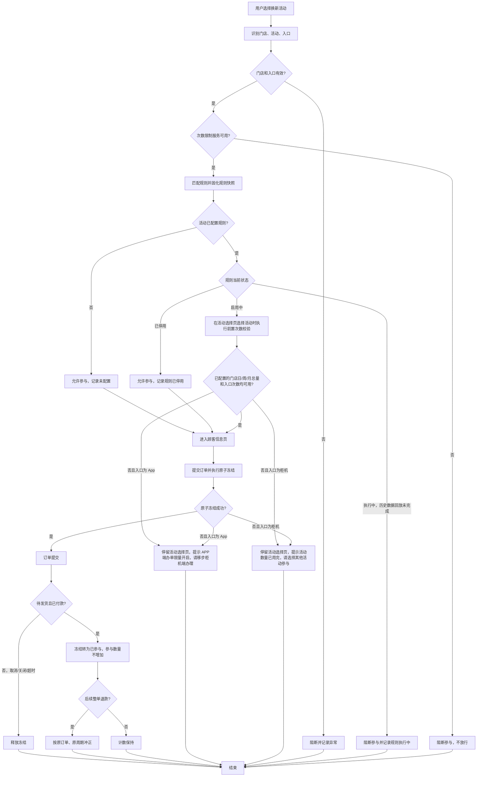

# 门店换新活动参与次数限制 PRD

> 版本：v1.2<br>
> 状态：草案，待业务与技术评审<br>
> 更新日期：2026-11-11

## 1. 文档信息

| 字段 | 内容 |
|---|---|
| 需求 ID | REQ-20261110-001 |
| 需求名称 | 门店换新活动参与次数限制 |
| 产品负责人 | 待定 |
| 关联系统 | 换新活动配置、柜机、App（软件）、订单中心、退款中心、运营后台 |
| 关联材料 | 本 PRD、配置菜单交互原型；后续补充接口规格和测试用例 |

## 2. 背景与目标

### 2.1 背景

当前一个门店可以配置多个换新活动，并同时存在柜机和 App 两个活动入口。现有活动配置主要按活动维度管理，缺少统一的门店参与次数控制，容易出现以下问题：

- 同一门店的不同活动分别参与，门店总参与量无法统一控制。
- 柜机和 App 两个入口可能各自绕过限制，无法形成门店级硬上限。
- 门店数量较多且持续新增，逐门店维护配置的成本高，也容易漏配。
- 成交、退款和活动切换后，次数缺少统一、可追溯的计数口径。

### 2.2 本期目标

1. 以“门店 × 规则 × 周期”为单位统计换新活动参与次数，限制门店整体参与量。
2. 配置规则不绑定具体门店，通过活动 ID 集合确定适用范围；规则自动覆盖所有参与这些活动的门店，包括新增门店。
3. 支持门店总次数、柜机分归宿次数、软件分归宿次数三类次数，按单日、自然周、单月周期独立选配；门店总量留空时，由对应周期的柜机/App 次数独立执行。
4. 仅当订单状态为“待发货”且付款状态为“已付款”时，每笔订单计 1 次；整单退款成功时按原订单还原 1 次。
5. 通过原子冻结和幂等处理，避免并发成交突破次数限制或重复计数。
6. 规则生效时回溯当前自然日、自然周、自然月历史成交，生成各门店期初用量，防止中途配置或重新启用绕过次数上限。
7. 提供规则维度的门店参与详情和订单明细，统一按“冻结中 + 已参与（成交）”统计参与数量。
8. 通过“执行中 → 启用中”状态展示历史数据回放过程，回放完成前不开始执行规则。
9. 将前端次数拦截前置到活动选择页，App 端使用专属引导文案，避免用户进入顾客信息页后才被拦截。

### 2.3 成功指标

| 指标 | 目标 | 测量方式 |
|---|---|---|
| 规则覆盖 | 命中规则的活动订单 100% 经过次数校验 | 订单侧校验日志 |
| 超限成交 | 同一规则、同一门店、同一周期内 0 笔超限成交 | 计数流水与订单对账 |
| 新门店覆盖 | 新门店参与规则内活动时无需补配置即可生效 | 新门店首单校验记录 |
| 退款冲正 | 整单退款 100% 可追溯，重复回调 0 次重复返还 | 退款流水与计数流水对账 |

> 当前没有基线数据，具体业务目标值待补充；上表先作为能力与质量目标。

## 3. 本期范围

### 3.1 本期包含

- 不绑定门店的次数限制规则管理。
- 活动 ID 集合配置：每条规则必须配置至少 1 个活动 ID，不支持全局不限活动的规则。
- 同一活动 ID 在所有配置中只能归属一条“启用中”或“执行中”规则；停用规则不占用活动。
- 门店日总数量、门店周总数量、门店月总数量限制，三项均可按周期分别留空。
- 柜机、软件按订单归宿分别设置日次数、周次数、月次数限制。
- 门店日/周/月总数量与柜机、App 的 6 项入口次数共 9 项均为选填，但每条规则至少配置 1 项；未配置门店某周期总量时，该周期按柜机/App 已填次数独立执行。
- 按订单归宿区分“柜机下单”和“软件下单”，App 入口订单归为软件下单；订单明细展示订单归宿。
- 柜机、App 在活动选择页选择活动并点击“参与活动”时的前置次数校验；App 命中次数限制时在活动选择页展示专属文案“APP端办单限量开启，请移步柜机端办理。”。
- 提交活动订单时的原子冻结和硬校验，防止前置校验通过后并发消耗导致超限成交。
- 订单状态与付款状态联合判定成交、成交计数、整单退款冲正和冲正流水。
- 规则启停、变更审计、参与详情、订单明细和异常记录。
- 规则批量导入：支持 CSV 整批校验、预览和创建。
- 配置操作日志：记录创建、编辑、启停和批量导入的变更前后值。
- 规则生效初始化：首次启用、重新启用和已启用规则新增活动时，按当前日/周/月历史成交生成期初用量。
- 次数上限按正整数校验，不另设业务封顶值；实际存储上限由技术统一校验，不得截断或转换为 0。
- 新增“执行中”状态：启用后先执行当前日/周/月历史数据回放，完成后进入“启用中”，此时才开始执行次数规则。
- 门店端不展示冻结、已参与或剩余次数，只展示参与结果和拦截提示。
- 新门店自动纳入；新活动由运营手工加入规则，不会自动套用其他规则。
- 配置菜单、规则列表、新建/编辑、启停、批量导入、活动占用校验、操作日志和交互反馈。

### 3.2 本期不包含

- 按具体门店维护白名单、黑名单或单独次数。
- 按顾客、手机号或会员账户限制活动参与次数。
- 活动预算、补贴库存、券库存和奖品库存控制。
- 改变活动补贴、回收价或结算价的计算逻辑。
- 一单多机；业务已明确一单一机，每单固定计 1 次。
- 回溯当前自然日、自然周、自然月以前的已成交订单；生效初始化只追溯到当前周期起点。
- “全店总次数 + 活动集合叠加限制”的多层嵌套规则；本期采用活动集合归属单一规则的方式。

## 4. 术语与口径

| 术语 | 定义 |
|---|---|
| 换新活动 | 业务上可参与以旧换新的活动；具体活动类型和活动 ID 以活动中心为准 |
| 门店 | 参与换新活动的门店主体，按门店 ID 唯一识别 |
| 入口 | 本期限定为柜机、App 两类；订单必须能识别实际成交入口 |
| 订单归宿 | 标识订单从哪个下单渠道产生，用于次数归属和拆分；取值仅允许“柜机下单”或“软件下单”。App 入口产生的订单归为“软件下单” |
| 规则 | 一组活动 ID 集合及其对应的门店参与次数上限 |
| 活动集合 | 规则覆盖的活动 ID 列表；每条规则至少包含 1 个活动，不支持为空或全局配置 |
| 成交 | 订单状态为“待发货”且付款状态为“已付款”；两个条件首次同时满足时计为成交 |
| 冻结中 | 活动订单提交后临时占用次数、尚未同时满足成交条件的订单状态；冻结中的订单计入参与数量 |
| 已参与 | 订单状态为“待发货”且付款状态为“已付款”的成交状态；已参与的订单计入参与数量 |
| 参与数量 | 门店在指定规则、指定周期内的参与订单总数，计算口径为“冻结中订单数 + 已参与（成交）订单数”；一单计一次 |
| 前置次数校验 | 用户在活动选择页选择活动并点击“参与活动”时执行的只读资格校验；不冻结、不占用次数，命中限制时停留在活动选择页并禁止进入顾客信息页 |
| 自然周 | 按 `Asia/Shanghai` 时区划分，周一 `00:00:00` 至下周一 `00:00:00`；跨月时仍作为完整自然周统计，不拆分到两个月 |
| 期初用量 | 规则生效时，按活动回溯当前自然日/周/月历史已成交订单形成的门店周期基线；计入当前周期上限，但不属于规则生效后的新增成交 |
| 生效初始化 | 新建启用、重新启用或新增活动时，为命中门店生成当前日/周/月期初用量并补建冻结中订单的过程；完成前规则处于“执行中” |
| 整单退款 | 订单全部内容及金额整单退款成功；系统不存在部分退款场景 |
| 规则快照 | 订单创建或冻结时记录的规则 ID、规则版本、活动集合和次数配置 |

订单归宿映射如下：

| 实际下单来源 | 订单归宿（展示值） | 订单归宿（枚举值） | 占用的次数配置 |
|---|---|---|---|
| 柜机 | 柜机下单 | `CABINET_ORDER` | 柜机日/周/月次数 |
| App/软件 | 软件下单 | `SOFTWARE_ORDER` | App 日/周/月次数，即软件下单次数 |

`entry_type`（`cabinet` / `app`）只用于记录原始来源和排障，不得作为计数归属依据；计数、退款和明细统一读取固化后的 `order_destination`。

## 5. 核心方案

### 5.1 设计原则

**配置不绑定门店，计数绑定门店。**

- 规则只配置活动 ID 集合和次数，不配置门店清单。
- 每个门店按同一规则独立计数，互不共享次数。
- 新门店首次参与规则内活动时自动创建计数记录，不需要补配置。
- 规则发布后，对所有参与规则内活动的门店生效。
- 每条规则必须配置活动 ID，不存在“全部活动”或空集合兜底规则。
- 同一活动 ID 只能被一条“启用中”或“执行中”规则占用；停用规则不参与唯一性校验，也不阻止其他规则配置该活动。
- 规则启用后先进入“执行中”，完成当前自然日、自然周、自然月的期初用量初始化后才进入“启用中”；禁止按 0 次开始执行。
- 每个次数字段按其自身周期独立生效；未配置门店周期总量时，门店合计数量仍持续统计和展示，但不作为该周期的拦截条件。

### 5.2 活动集合与规则归属

#### 5.2.1 活跃活动唯一占用

1. 每条规则必须至少配置 1 个活动 ID；活动 ID 是必填字段，不能留空。
2. 同一活动 ID 在所有配置中只能归属一条“启用中”或“执行中”规则；本稿将这两种状态统称为“活跃规则”。
3. 停用规则不占用活动。同一活动可以同时出现在一条活跃规则和任意数量的停用规则中，也可以只出现在多条停用规则中。
4. 将停用规则启用时，系统必须重新校验其活动是否已被其他活跃规则占用；存在冲突时阻断启用，规则保持停用。
5. 活跃规则停用后立即释放活动占用；其他规则通过保存或启用校验后即可使用该活动。
6. 同一规则内多个活动共享该规则的次数池。
7. 同一门店可同时命中多条活动集合互不重叠的活跃规则，各规则形成独立次数池。
8. 不同规则之间的次数不共享、不叠加、不互相抵扣。
9. 保存为启用或执行状态时发现活动 ID 已被其他活跃规则占用，必须整体阻断，不做自动合并或静默迁移；保存为停用状态时不做活跃占用校验。
10. 活动 ID 以活动中心返回的唯一 ID 为准，按精确值判重，不按活动名称判重。
11. 活跃配置的占用校验必须在服务端使用原子操作或等效锁机制，避免两个并发启用请求同时占用同一活动。

#### 5.2.2 规则示例

示例：

| 规则 | 活动集合 | 门店日总数量 | 门店周总数量 | 门店月总数量 |
|---|---|---:|---:|---:|
| 规则 A | 活动 A1、A2 | 10 | 60 | 200 |
| 规则 B | 活动 B1、B2 | 5 | 30 | 80 |

同一门店参与 A1、A2 时消耗规则 A 的次数；参与 B1、B2 时消耗规则 B 的次数。两个次数池互不影响。

> 上表仅展示三项门店总量均已配置的示例。门店日、周、月总量也可分别留空，具体规则见 5.3。

#### 5.2.3 未纳入配置的活动

- 未被任何规则覆盖的换新活动不执行本次数限制，但必须记录“活动未纳入次数限制配置”的校验结果。
- 新活动不会自动加入已有规则，需运营明确选择后方可受控。

### 5.3 次数维度

每条规则的活动 ID 集合必填；门店日、周、月总数量与柜机、App 的日/周/月次数共 9 项均为选填，但 9 项中至少配置 1 项。每个已填写的次数只在自己的周期与计数范围内执行，留空表示不执行对应限制，不表示限制为 0：

| 字段 | 周期 | 是否必填 | 说明 |
|---|---|---|---|
| 活动 ID 集合 | 不区分周期 | 是 | 至少 1 个活动；集合内活动共用本规则次数 |
| 门店日总数量 | 单日 | 否 | 规则内所有活动、柜机和 App 的当日合计上限；留空则该周期不执行门店级拦截 |
| 门店周总数量 | 自然周 | 否 | 规则内所有活动、柜机和 App 的自然周累计上限；留空则该周期不执行门店级拦截 |
| 门店月总数量 | 单月 | 否 | 规则内所有活动、柜机和 App 的当月累计上限；留空则该周期不执行门店级拦截 |
| 柜机日次数 | 单日 | 否 | 柜机下单的当日次数上限；未填写则不执行柜机日限制 |
| 柜机周次数 | 自然周 | 否 | 柜机下单的自然周次数上限；未填写则不执行柜机周限制 |
| 柜机月次数 | 单月 | 否 | 柜机下单的当月次数上限；未填写则不执行柜机月限制 |
| App 日次数 | 单日 | 否 | 软件下单的当日次数上限；未填写则不执行软件日限制 |
| App 周次数 | 自然周 | 否 | 软件下单的自然周次数上限；未填写则不执行软件周限制 |
| App 月次数 | 单月 | 否 | 软件下单的当月次数上限；未填写则不执行软件月限制 |

规则：

- 柜机次数对应订单归宿为“柜机下单”，App 次数对应订单归宿为“软件下单”，两列次数不得混用。
- 活动 ID 集合必填；门店日/周/月总数量与柜机、App 的日/周/月次数共 9 项全部选填，但每条规则至少填写 1 项，否则保存和导入均失败。
- 门店日/周/月总数量及柜机、App 的日/周/月次数一旦填写，必须为正整数，不允许 0、负数、小数、空值和特殊字符；留空不执行对应周期限制，不表示限制为 0。
- 门店日总数量、门店周总数量、门店月总数量分别按自然日、自然周、自然月独立执行；某一周期留空时，该周期不执行门店总量限制。已配置的周期仍需同时满足门店总量和对应入口次数。
- 未配置门店某周期总数量时，该周期按柜机或 App 已填写的入口次数独立计算和拦截：柜机订单只受柜机次数约束，软件订单只受 App 次数约束，两个入口不互相占用对方次数。
- 门店合计数量始终按“柜机下单数量 + 软件下单数量”统计并在参与详情展示；未配置门店周期总量仅表示不做门店级拦截，不影响门店合计统计。
- 若某周期既未配置门店总量，也未配置对应入口次数，则该周期不执行任何次数限制；但整条规则仍必须至少配置 1 项次数，不能出现 9 项全部为空。
- 日、周、月上限相互独立，不强制“日 ≤ 周 ≤ 月”。
- 柜机下单与软件下单分别统计；每笔订单只计入其订单归宿对应的次数，同时计入门店合计数量，两类归宿数量之和等于门店合计数量。
- 已配置的门店总量与入口次数共同生效：每笔订单必须同时满足已配置的门店周期总量和其订单归宿次数。未配置门店周期总量时，只校验该周期已填写的入口次数；分入口上限不要求相加等于或小于门店上限。
- 次数上限不另设业务封顶值，只接受正整数；技术侧需统一处理存储上限和超范围校验，禁止截断、溢出或静默改为 0。
- 业务需要停止某个活动时，应停用活动或规则，不应通过配置 0 次实现。

### 5.4 计数规则

#### 5.4.1 计数对象与维度

计数对象为“门店 × 规则 × 周期”：

- 每个门店在每个规则下拥有独立计数，不与其他门店共享。
- 每条规则分别维护单日、自然周和单月计数。
- 每个周期分别记录门店总数、柜机下单数和软件下单数的“冻结中”与“已参与”数量；App 入口对应软件下单维度。
- 参与数量 = 冻结中数量 + 已参与（成交）数量；门店总数量、柜机数量和 App 数量均按该口径统计。
- 可用次数仅对已配置上限计算：可用次数 = 对应上限 - 冻结中数量 - 已参与数量；冻结中的订单已经占用次数，不得再次放行。未配置的周期不计算门店级可用次数，也不作为拦截条件。

#### 5.4.2 成交计数

订单状态为“待发货”且付款状态为“已付款”时，判定为成交并执行以下变更：

1. 若订单已存在冻结记录，将门店总数和对应订单归宿的“冻结中”各 `-1`，“已参与”各 `+1`；参与数量净值不变。
2. 若订单没有冻结记录，先校验已配置的门店周期总量和对应订单归宿次数仍可用，再将门店合计数量与对应订单归宿的“已参与”各 `+1`。
3. 按订单归宿，只增加“柜机下单”或“软件下单”中的一个维度；App 入口订单归为软件下单。
4. 写入计数流水，记录订单号、门店、规则、规则版本、活动 ID、订单归宿、周期、冻结转已参与或直接计入的结果和操作时间。
5. 同一订单号只允许成功计入一次；重复成交事件不重复增加。

其他口径：

- 业务不存在一单多机，一单一机；每笔订单固定计 1 次。
- 每笔订单只能有一个订单归宿，不允许同时归属柜机下单和软件下单。
- 订单归宿在订单创建或冻结时写入快照并固化；后续成交、退款和报表均以该快照为准，不得根据订单当前所在系统、设备或访问来源重新推断。
- 仅订单状态为“待发货”、付款状态仍为“已付款”时才转为“已参与”；任一条件不满足时保持“冻结中”，已冻结订单继续占用次数。
- 当两个状态由不同事件先后到达时，以服务端首次同时满足“待发货 + 已付款”的时间作为成交时间。
- 取消、关闭、超时或提交失败时释放冻结，不再计入参与数量；未创建冻结记录的未成交订单不计数。
- 已冻结订单的计数周期按首次冻结时间归属；成交后保持原日/周/月周期，仅将状态由冻结中改为已参与，避免跨周期迁移造成重复占用或漏计。
- 未创建冻结记录、由历史成交事件补录的订单按成交时间归属周期。
- 计数周期时区为 `Asia/Shanghai`。
- 单日周期为自然日 `00:00:00` 至次日 `00:00:00`；单月周期为自然月 1 日 `00:00:00` 至次月 1 日 `00:00:00`。
- 单周周期为自然周周一 `00:00:00` 至下周一 `00:00:00`；跨月自然周按其实际起止日期独立统计，不拆分到两个月份。
- 订单成交事件晚到或乱序时，仍按成交时间归属原周期，并保留流水。
- 查询生效初始化所需的历史成交时，必须按成交时间或状态历史计算，不得按查询时的当前订单状态反推。

#### 5.4.3 冻结与并发控制

为保证前置提示及时、最终限制不被并发穿透，采用“活动选择页前置校验 + 提交订单原子冻结”的两阶段控制：

1. 用户在活动选择页选择活动并点击“参与活动”时，前端调用只读的前置次数校验；系统定位门店、活动、订单归宿和命中规则，使用“冻结中数量 + 已参与数量”计算已配置周期的门店总量和对应订单归宿次数。
2. 任一已配置周期不足时，停留在活动选择页，不进入顾客信息页。App 端提示“APP端办单限量开启，请移步柜机端办理。”，柜机端提示“活动数量已用完，请选择其他活动参与。”；前置校验不创建冻结记录，也不增加或释放用量。
3. 前置校验通过后允许进入顾客信息页。该结果仅代表点击“参与活动”时点可用，不得作为最终占用依据；用户返回活动选择页后再次参与时必须重新校验，不得沿用上次结果。
4. 用户提交订单时，系统必须在同一原子操作中重新校验并冻结次数。校验通过后，原子增加门店总数和订单归宿对应的冻结数量；任一维度不足则阻断，不创建冻结记录和订单。
5. 提交订单的硬校验失败时，App 端展示同一专属文案，柜机端展示通用文案；用户停留在顾客信息页，不得继续提交或转成非活动订单。
6. 订单成交后，将同一订单的冻结记录转为“已参与”，参与数量不再次增加，避免重复计数。
7. 取消、关闭、超时或提交失败时释放冻结，冻结数量 `-1`；上述订单不再出现在参与详情中。
8. 并发请求必须使用原子操作或等效锁机制，不能出现两个请求同时占用最后 1 个次数并都成功的情况。
9. 冻结记录必须覆盖门店已配置的日/自然周/自然月总次数周期，以及已填写的柜机/软件分归宿周期；任一已配置周期不足均阻断。未配置门店某周期总量时，该周期仍记录门店合计统计快照，但不作为拦截条件，柜机/软件按各自已填次数独立校验。

如果订单无法完成冻结，则不允许作为活动订单继续提交。次数限制服务异常时不得放行，统一阻断并提示稍后重试。

#### 5.4.4 门店和订单归宿异常

- 无法识别门店 ID 时，不允许参与活动，记录异常并提示联系管理员。
- 订单归宿只能为“柜机下单”或“软件下单”；App 入口需映射为“软件下单”。归宿为空、非法、同时命中两类或无法映射时，不允许进入正式计数，进入异常队列并告警。
- 活动未命中任何规则时不限制，但必须记录“活动未纳入次数限制配置”的校验结果，便于追溯。

### 5.5 退款还原

- 业务不存在部分退款，仅处理整单退款。
- 订单整单退款成功后，门店总“已参与”数量 `-1`，原订单归宿的“已参与”数量 `-1`；冻结数量不变。
- 次数按日、周、月分别还原到原成交订单所属的原周期，不回补到退款发生当期。
- 同一订单只允许一次正向计数和一次反向冲正；重复退款回调、重复消息不重复返还。
- 退款按订单创建时固化的规则快照处理，不因规则停用或活动移出集合而改变归属。
- 冲正流水必须记录原订单号、退款单号、规则 ID、规则版本、活动 ID、订单归宿、原周期和操作时间。
- 订单完成一次冲正后，即使状态被人工回滚，也不得自动再次计数；需要重新计数的场景走人工审批和补录流程。
- 冲正完成后订单不再占用参与数量，从参与详情和订单明细的当前有效记录中移除。

### 5.6 生效初始化与规则变更

#### 5.6.1 生效初始化触发条件

规则每次从不生效变为生效，或已生效规则的受控活动范围扩大时，必须完成生效初始化。触发场景包括：

1. 新建规则并选择“保存并启用”。
2. 停用规则重新启用。
3. 已启用规则新增活动，只初始化新增活动的历史用量。
4. 批量导入规则并选择启用。

保存为停用、仅修改规则名称、备注或次数上限、减少活动集合时，不触发重新初始化。

#### 5.6.2 期初用量口径

1. 初始化截止时刻为规则进入“执行中”的服务端时刻；订单成交时间早于该时刻且落在当前周期内的订单，纳入期初用量。执行中期间规则内活动统一阻断新参与，因此不会产生新的运行态成交；完成初始化并进入“启用中”后，才由运行态计数处理。
2. 单日统计范围为进入执行中当日 `00:00:00` 至截止时刻之前；自然周统计范围为进入执行中所在自然周周一 `00:00:00` 至截止时刻之前；单月统计范围为进入执行中当月 1 日 `00:00:00` 至截止时刻之前。跨月自然周包含上月日期时，按自然周实际范围一并统计。
3. 按“门店 × 规则 × 周期”汇总，分别计算门店合计数量、柜机下单数量和软件下单数量；一单仍只计 1 次，柜机下单与软件下单不重复累加。初始化始终生成日、周、月三类用量以支持参与详情；运行时仅校验已填写的门店总量和入口次数，未填写的门店周期不参与拦截。
4. 同一订单号在同一规则、同一周期内只能初始化一次；重新启用或任务重试时，已存在的订单流水必须跳过，不能重复累加。已发生整单退款并完成冲正的订单视为无效订单，不得再次纳入期初用量。
5. 初始化结果写入期初用量和标识为 `INITIALIZE` 的计数流水，并计入当前周期已参与数量；不得伪装成规则生效后的新增成交。
6. 已启用规则新增活动时，只回溯新增活动在周期起点至生效时刻的历史订单；规则内已计数的订单不重复纳入。
7. 停用后重新启用时，必须重新核对当前自然日、自然周、自然月内的全部活动订单，包含停用期间产生的成交，确保重新受控后不会从旧基线继续放行。
8. 保存前已创建、尚未成交的活动订单必须补建冻结记录；补建失败时整次生效失败，不得留下未受控的在途订单。
9. 期初订单在后续整单退款时，按原订单、原规则、原周期执行冲正，避免退款后次数无法还原。
10. 历史成交按“成交事件 - 已完成的退款冲正事件”计算净次数：退款发生在生效时刻之前时，该订单不计入期初用量；退款发生在生效时刻之后时，先计入期初用量，再按运行态退款冲正。事件时间相同按同一幂等事务处理，不能出现多计或漏计。
11. 存量订单在首次初始化前完成订单归宿迁移：由可追溯的原始来源一次性映射为 `CABINET_ORDER` 或 `SOFTWARE_ORDER` 并固化，后续不得根据当前系统或访问来源重新推断。来源缺失、非法或冲突的存量订单不得默认归类，必须列明异常订单并阻断本次生效，禁止按 0 次或单边归宿放行。

示例：某门店当月已成交 40 次、当周已成交 12 次、当日已成交 3 次。规则在 15:00 首次启用，月总数量 100、周总数量 30、日总数量 10；初始化后该门店当月剩余 60 次、当周剩余 18 次、当日剩余 7 次，而不是分别从 100 次、30 次和 10 次重新开始。

示例：规则仅配置柜机日次数 2、App 日次数 3，门店日/周/月总数量均留空。初始化仍生成门店及两个入口的当前日/周/月统计，但日周期只按柜机第 3 单、软件第 4 单分别阻断；门店合计数量继续累计用于展示，周/月周期未配置任何限制时不做拦截。

#### 5.6.3 执行中状态、失败与幂等

规则状态及含义：

| 状态 | 含义 | 是否执行次数规则 |
|---|---|---|
| 执行中 | 已发起启用或重新启用，正在回溯当前日/周/月历史成交并补建冻结记录 | 否，规则内活动阻断新参与 |
| 启用中 | 历史数据回放成功，规则开始执行次数校验和冻结 | 是 |
| 已停用 | 规则不执行次数校验，可重新启用 | 否 |

状态流转与约束：

1. 新建规则选择“保存并启用”或已停用规则点击“启用”时，规则先进入“执行中”，不得直接进入“启用中”。
2. 历史数据回放、期初用量写入和冻结记录补建全部成功后，“执行中”自动更新为“启用中”，从该时刻起按规则执行次数校验。
3. 执行中规则尚未开始执行次数规则，所有命中活动统一阻断新参与，防止历史数据未初始化时绕过限制。
4. “执行中”期间不允许编辑、重复启用或停用；操作列展示“历史数据处理中”。任务失败时回到“已停用”，并记录失败原因。
5. 已启用规则新增活动时，规则整体保持“启用中”；原有活动继续执行，新增活动在增量初始化完成前阻断参与，并在规则列表标记“新增活动初始化中”。
6. 禁止出现历史查询失败后按 0 次初始化并继续放行的降级逻辑。新建或重新启用失败时保持“已停用”；已启用规则新增活动失败时保留原生效版本，新增活动保持阻断。
7. 初始化任务可异步执行，完成后必须以服务端状态回写为准；前端轮询或刷新时不得仅凭本地状态展示“启用中”。
8. 规则操作日志必须分别记录“开始执行”（状态变为执行中）和“初始化完成”（状态变为启用中）或“执行失败”（回滚状态）的结果。

其他幂等与审计要求：

- 初始化任务必须记录生效批次 ID、规则版本、统计周期、命中门店数、历史订单数、各维度期初用量、操作人、开始时间、完成时间和失败原因。
- 初始化任务必须支持幂等重试；同一生效批次重复执行不得重复写入用量或流水。
- 执行中任务的开始、完成和失败都必须写操作日志；日志时间为服务端时间。

#### 5.6.4 生效后的规则变更

- 订单创建或冻结时固化规则快照；成交计数和退款冲正均按快照归属。
- 规则停用只阻止新订单冻结，已冻结订单可以继续成交并按快照计数。
- 将次数调低到低于当前参与数量时，不删除历史计数和期初用量；后续新订单立即按新次数阻断。
- 增加活动按 5.6.1 执行增量初始化；减少活动时，历史用量不返还、不迁移，后续订单不再计入该规则。
- 将活动从一个规则移到另一个规则时，新规则需按生效初始化口径纳入当前周期历史用量；原规则历史用量保留，退款仍回原规则。
- 本期只支持“门店日/周/月总次数 + 柜机/软件分归宿次数”，不支持“全店总次数 + 活动集合叠加限制”的多层嵌套规则。

## 6. 配置管理

### 6.1 页面结构

运营后台新增“换新活动次数限制”页面，包含：

1. 左侧配置菜单及“换新活动次数限制”入口。
2. 规则列表和筛选。
3. 新建/编辑规则。
4. 活动 ID 选择与活跃规则占用校验。
5. 批量导入规则。
6. 规则列表中的最近操作日志摘要与完整变更记录。
7. 规则参与详情与门店订单明细。
8. 计数流水和退款冲正流水。
9. “执行中 → 启用中”的生效处理状态、统计范围和失败原因。

页面不提供门店选择器，不要求维护门店清单。页面需明确提示“规则自动应用于所有参与所选活动的门店”。

交互原型仅保留“换新活动次数限制”一个侧栏菜单入口，避免评审时误认为存在其他配置页面。原型覆盖规则列表、新建、编辑、批量导入、操作日志、活动占用校验、启用/停用、执行中状态、参与详情和订单明细。

门店端只展示参与结果、拦截提示和联系客服信息，不展示规则配置、冻结中数量、已参与数量或剩余次数。

### 6.2 规则字段

| 字段 | 类型 | 必填 | 规则 |
|---|---|---|---|
| 规则名称 | 文本 | 否 | 用于运营识别；留空时按规则 ID 自动生成“未命名次数规则 R-xxx” |
| 活动 ID 集合 | 多选或批量输入 | 是 | 至少 1 个；支持搜索、多选和批量粘贴；同一活动只能被一条启用中或执行中规则占用 |
| 门店日总数量 | 正整数 | 否 | 当日门店全部活动、全部订单归宿的合计次数上限；留空则不执行门店日拦截 |
| 门店周总数量 | 正整数 | 否 | 自然周内门店全部活动、全部订单归宿的合计次数上限；留空则不执行门店周拦截 |
| 门店月总数量 | 正整数 | 否 | 当月门店全部活动、全部订单归宿的累计次数上限；留空则不执行门店月拦截 |
| 柜机日次数 | 正整数 | 否 | 柜机下单的当日次数上限；未填写则不执行柜机日限制 |
| 柜机周次数 | 正整数 | 否 | 柜机下单的自然周次数上限；未填写则不执行柜机周限制 |
| 柜机月次数 | 正整数 | 否 | 柜机下单的当月次数上限；未填写则不执行柜机月限制 |
| App 日次数 | 正整数 | 否 | 软件下单的当日次数上限；未填写则不执行软件日限制 |
| App 周次数 | 正整数 | 否 | 软件下单的自然周次数上限；未填写则不执行软件周限制 |
| App 月次数 | 正整数 | 否 | 软件下单的当月次数上限；未填写则不执行软件月限制 |
| 状态 | 执行中/启用中/已停用 | 否 | 新建并启用或重新启用时先进入执行中，历史数据回放成功后变为启用中；用户不能直接选择执行中 |
| 备注 | 文本 | 否 | 记录调整原因、活动周期等 |

> 活动 ID 集合必填；门店日/周/月总数量及 6 个分归宿次数共 9 项均选填，但 9 项至少填写 1 项。留空表示不执行对应周期限制，不按 0 次处理。未配置门店某周期总量时，该周期按柜机/App 已填入口次数独立执行。

所有已填写的次数上限按正整数校验，不设置额外业务封顶值；技术侧如存在存储上限，应在输入时明确提示并阻断，不得静默截断或按 0 处理。

### 6.3 保存校验

保存时按以下顺序校验，任一失败则整体不保存：

1. 活动 ID 集合不能为空，且每条规则至少保留 1 个有效活动。
2. 活动 ID 必须存在且属于换新活动类型。
3. 保存为启用或执行状态时，同一活动 ID 不能被其他启用中或执行中规则占用；校验排除当前规则自身。保存为停用状态时不做活跃占用校验。
4. 门店日/周/月总数量与柜机、App 的日/周/月次数共 9 项至少填写 1 项；全部为空时阻断保存。
5. 上述 9 项次数一旦填写必须为正整数；留空表示不执行对应周期限制。
6. 活动 ID 不存在或活动类型不符时，阻断保存并展示具体活动 ID。
7. 同一规则内重复添加同一活动 ID 时，去重并提示；被其他活跃规则重复占用时必须阻断并展示占用规则名称。
8. 规则名称可留空；保存时自动生成默认名称。状态未操作时按启用保存。
9. 启用已停用规则前，必须重新校验活动是否与其他活跃规则冲突；冲突时阻断启用，规则保持已停用。
10. 启用规则后先进入“执行中”，完成当前自然日、自然周、自然月的期初用量初始化及冻结中订单补建后才可变为“启用中”；任一命中门店初始化失败、历史成交查询失败或服务异常时，规则不得变为启用中，按 5.6.3 回退状态并记录日志。

### 6.4 列表与详情

规则列表至少展示：

- 规则名称、活动 ID、活动数量。
- 门店日、周、月总数量；分别选填，已配置周期执行，未配置周期显示“不执行”。
- 柜机日/周/月次数、App 日/周/月次数；未配置的入口周期显示“不执行”。
- 门店周期总量未配置时，展示该周期柜机/App 独立执行次数，便于运营识别实际拦截口径。
- 状态：执行中、启用中、已停用；执行中展示“历史数据处理中”，不可编辑或重复启停。
- 参与详情：点击打开当前规则的参与详情弹窗。
- 最近一条操作日志摘要：操作类型、操作人、操作时间及主要变更前后值。
- 操作：参与详情、查看操作日志、编辑、启用、停用。执行中规则隐藏或禁用编辑、启用和停用操作。

规则详情至少展示：

- 规则配置和版本。
- 覆盖的活动 ID 及活动名称。
- 当前生效状态和活跃活动占用校验结果。
- 生效初始化结果：生效批次、生效时刻、命中门店数、历史订单数、日/周/月期初用量和失败原因。
- 按门店展示当前参与数量：门店日/周/月数量、柜机日/周/月数量、App 日/周/月数量；数量 = 冻结中 + 已参与（成交）。
- 完整操作日志，包括创建、编辑、启停和批量导入的变更前后值。
- 计数流水、冻结流水、释放流水和退款冲正流水。

### 6.5 参与详情与订单明细

参与详情仅在运营后台向运营管理员、业务查看者和技术支持开放，门店端不提供该查询能力。门店人员不允许查看冻结中数量、已参与数量或剩余次数。

#### 6.5.1 参与详情弹窗

在规则列表点击“参与详情”打开弹窗，按门店展示该规则当前自然日、自然周、自然月的参与数量。默认展示当前日、周或月中仍有参与数据的门店；没有数据时展示空状态，不展示全量未参与门店。

| 字段 | 说明 |
|---|---|
| 门店名称 | 门店名称；可展示门店 ID 作为副信息 |
| 柜机日数量 | 当前自然日柜机入口的冻结中数量 + 已参与（成交）数量 |
| App 日数量 | 当前自然日 App 入口的冻结中数量 + 已参与（成交）数量 |
| 门店日数量 | 当前自然日全部活动的冻结中数量 + 已参与（成交）数量，等于柜机日数量与 App 日数量之和 |
| 门店周数量 | 当前自然周全部活动的冻结中数量 + 已参与（成交）数量，等于柜机周数量与 App 周数量之和 |
| 柜机周数量 | 当前自然周柜机入口的冻结中数量 + 已参与（成交）数量 |
| App 周数量 | 当前自然周 App 入口的冻结中数量 + 已参与（成交）数量 |
| 门店月数量 | 当前自然月全部活动的冻结中数量 + 已参与（成交）数量，等于柜机月数量与 App 月数量之和 |
| 柜机月数量 | 当前自然月柜机入口的冻结中数量 + 已参与（成交）数量 |
| App 月数量 | 当前自然月 App 入口的冻结中数量 + 已参与（成交）数量 |
| 查看明细 | 打开当前门店的订单明细弹窗 |

弹窗顶部必须提示“数量包含冻结中与已参与（成交）订单，不包含已退款或已释放订单”。每个数量可在悬浮说明或辅助文本中拆分“冻结中 X + 已参与 Y”，但主数量统一使用合计值。门店某周期总数量未配置时，对应门店数量仍作为合计统计展示，但不用于拦截；柜机/App 按各自已填次数独立执行。参与详情按门店分页，支持按门店名称或门店 ID 搜索；数据读取失败时展示错误，不得把服务异常展示为 0 或空列表。

其中柜机数量按订单归宿为“柜机下单”的订单统计，App 数量按订单归宿为“软件下单”的订单统计；门店数量为两类归宿合计。

#### 6.5.2 订单明细弹窗

点击某门店的“查看明细”，打开订单明细弹窗。弹窗仅展示当前仍占用次数的订单：

| 字段 | 说明 |
|---|---|
| 门店名称 | 当前规则、当前门店名称 |
| 订单号 | 换新活动订单号 |
| 订单归宿 | `柜机下单` 或 `软件下单`；App 入口订单展示为软件下单 |
| 参与状态 | `冻结中` 或 `已参与`；不展示其他订单状态 |

展示规则：

1. 明细覆盖当前自然周与当前自然月并集内仍占用次数的订单；当日订单是当前自然周和当前自然月子集。跨月自然周中属于上月的订单也必须展示。
2. 同一订单同时占用日、周、月维度时只展示一次，按订单号去重。
3. 已退款并完成冲正、已取消、已关闭、超时释放或冻结失败的订单不展示。
4. 只展示门店名称、订单号、订单归宿和参与状态 4 个字段，不额外展示活动、成交时间或金额；完整周期和流水信息保留在后台供排障。
5. 按订单号分页或懒加载；服务异常时明确提示加载失败，不得展示伪造空列表。
6. 订单归宿必须读取订单创建或冻结时固化的快照，不得根据查询时的入口状态重新判断；缺失、非法或多归宿的订单不得进入订单明细。

#### 6.5.3 展示与刷新

- 规则列表的“参与详情”按当前规则读取；点击时重新拉取最新数据，不使用列表页缓存中的旧数量。
- 参与详情按门店分页，默认每页 20 家门店，支持按门店名称或门店 ID 搜索。门店排序按参与数量降序、门店 ID 升序，保证运营定位高频门店。
- 订单明细按订单号分页，默认每页 20 笔。订单按首次冻结时间倒序排列；同一订单只展示一次，不因日/周/月周期重复出现。
- 执行中规则允许查看参与详情，但应展示空状态与“历史数据回放中”的说明；不得把未开始执行误表示为 0 次。
- 页面展示的 9 个日/周/月数量字段均为只读快照，刷新弹窗时重新读取；数据加载失败展示错误态和重试入口，不得展示全 0 或旧数据冒充最新结果。
- 关闭订单明细后返回参与详情，并保留原门店搜索、分页和滚动位置；关闭参与详情后焦点返回触发按钮。

#### 6.5.4 权限与操作边界

- 门店人员不可查看参与详情和订单明细，也不可见冻结中、已参与或剩余次数。
- 参与详情和订单明细为只读，不提供修改订单状态、释放冻结或补录次数的操作。
- 查看行为记录请求 ID、操作人、规则 ID、门店范围和时间，用于审计和排障。

### 6.6 批量导入

#### 6.6.1 导入入口与格式

配置列表提供“批量导入”入口，支持粘贴 CSV 内容或上传 `.csv` 文件。UTF-8 编码，一行代表一条规则。表头固定为：

```text
规则名称,活动ID集合,门店日总数量,门店周总数量,门店月总数量,柜机日次数,柜机周次数,柜机月次数,App日次数,App周次数,App月次数,状态
```

| 字段 | 必填 | 导入规则 |
|---|---|---|
| 规则名称 | 否 | 最长 40 个字符；留空时由系统按规则 ID 自动生成 |
| 活动 ID 集合 | 是 | 至少 1 个活动 ID；多个活动使用半角竖线分隔；导入为启用时，不能与其他启用中/执行中规则或本批次其他启用行重复；导入为停用时不校验活跃占用 |
| 门店日总数量 | 否 | 留空表示不执行门店日拦截；填写后必须大于 0 的整数 |
| 门店周总数量 | 否 | 留空表示不执行门店周拦截；填写后必须大于 0 的整数，周按自然周执行 |
| 门店月总数量 | 否 | 留空表示不执行门店月拦截；填写后必须大于 0 的整数 |
| 柜机日次数 | 否 | 留空表示不执行；填写后必须大于 0 的整数 |
| 柜机周次数 | 否 | 留空表示不执行；填写后必须大于 0 的整数 |
| 柜机月次数 | 否 | 留空表示不执行；填写后必须大于 0 的整数 |
| App 日次数 | 否 | 留空表示不执行；填写后必须大于 0 的整数 |
| App 周次数 | 否 | 留空表示不执行；填写后必须大于 0 的整数 |
| App 月次数 | 否 | 留空表示不执行；填写后必须大于 0 的整数 |
| 状态 | 否 | 支持“启用”“停用”；留空默认启用。启用项导入成功后先进入“执行中”，历史数据回放完成后变为“启用中” |

运营可下载 CSV 模板。规则 ID 不由导入文件指定，统一由系统生成，避免外部覆盖已有配置。

每行 9 项次数中至少填写 1 项；全部为空时该行校验失败并阻断整批导入。门店日/周/月总数量及柜机、App 各周期次数均可按需留空，留空项按“不执行”保存并在运行时跳过对应限制。

旧版 9 列模板缺少周字段。由于周字段现已改为选填，系统仍兼容旧版模板，缺失的门店周总数量、柜机周次数和 App 周次数按“不执行”处理；新旧格式不得在同一批次混用。

#### 6.6.2 校验与导入

1. 用户粘贴内容或选择文件后，点击“校验并预览”。
2. 系统逐行校验活动 ID、9 项次数至少填写 1 项、次数格式、状态值、活动是否存在、活动类型和活跃规则占用关系。
3. 预览展示每行解析结果，并定位到原始行号给出具体错误。
4. 任一行校验失败时，整批不导入，不允许只写入部分行。
5. 全部行校验通过后，“确认导入”按钮才可点击；确认后在同一事务内创建全部规则。
6. 导入状态为启用的规则进入“执行中”，系统完成生效初始化后自动变为“启用中”；任一条规则初始化失败时，整批导入失败并回滚本批次全部规则与期初数据，不允许只保留部分规则、部分启用或部分期初用量。
7. 导入成功后生成导入批次号，每条新规则写入一条“批量导入创建”操作日志，并记录批次号；启用的规则另写入“开始执行”和“初始化完成/执行失败”操作日志。
8. 导入为启用时，同一活动在本批次其他启用行重复，或已被已有启用中/执行中规则占用，阻断整批导入；导入为停用时允许与任意状态规则重复。
9. 导入时再次执行完整校验，避免预览后配置被其他运营修改而导致活跃规则重复占用；停用规则后续启用时仍需重新校验。
10. 单次导入条数上限待技术评估；超过上限时提示分批导入。

### 6.7 操作日志

操作日志用于追溯“谁在什么时间改了什么，改动前后分别是什么”，与运行时计数流水、冻结流水和退款冲正流水分开管理。

#### 6.7.1 记录范围

以下操作必须生成操作日志：

- 创建规则。
- 编辑规则字段，包括活动集合、门店日/周/月总数量、柜机/软件分归宿次数、名称和状态。
- 启用或停用规则。
- 规则进入“执行中”、历史数据回放完成转为“启用中”或执行失败回退状态。
- 通过批量导入创建规则。
- 规则生效初始化成功或失败，包括生效批次、统计范围、命中门店数、期初用量和冻结订单补建结果。
- 活动占用冲突、导入失败等被系统阻断的写操作，记录失败原因和请求结果，但不生成规则版本。

取消编辑、未提交表单和保存时没有任何字段变化的操作，不生成新的操作日志。

#### 6.7.2 日志字段

| 字段 | 说明 |
|---|---|
| 日志 ID | 操作日志唯一标识 |
| 规则 ID / 规则名称 | 被操作的规则；创建操作在成功后写入规则 ID |
| 操作类型 | 创建、编辑、启用、停用、进入执行中、初始化完成、执行失败、批量导入创建 |
| 操作人 | 账号 ID、姓名和角色快照 |
| 操作时间 | 服务端时间，精确到秒 |
| 变更字段 | 发生变化的字段清单；创建时记录初始配置 |
| 变更前值 / 变更后值 | 按字段逐项记录；空门店总量或空入口次数统一显示为“不执行” |
| 导入批次号 | 批量导入创建时必填，同一批次规则共用批次号 |
| 请求结果 | 成功或失败；失败记录错误码和原因 |
| 请求 ID | 用于关联接口日志和排障 |

#### 6.7.3 展示与留存

- 规则列表展示最近一条操作日志的类型、操作人、时间和主要变更摘要。
- 点击日志摘要打开完整时间线，按时间倒序展示所有记录。
- 日志详情逐项展示字段、变更前值和变更后值；活动集合按完整活动 ID 列表记录。
- 操作日志只读，不允许业务前端编辑或删除。
- 历史日志至少保留到对应活动的财务、审计追溯期结束；规则停用、归档不删除日志。
- 仅具有配置查看权限的角色可以查看操作日志。

## 7. 主流程



前置校验与提交硬校验的执行要求：

- 前置校验必须发生在用户在活动选择页选择活动并点击“参与活动”时，校验未通过不得进入顾客信息页后再弹窗。
- 前置校验为只读操作，不得冻结次数、创建订单或改变参与数量；真正占用次数只发生在提交订单的原子冻结步骤。
- 因为前置校验不锁定次数，前后端必须保留提交时的二次硬校验。若前置校验后次数被其他订单耗尽，提交必须失败，不允许超限成交。
- App 端的前置校验和提交硬校验命中次数限制时，均使用专属文案；柜机端始终使用通用次数耗尽文案。

## 8. 前端拦截与提示

### 8.1 执行时点

1. 用户在柜机或 App 的活动选择页选择活动并点击“参与活动”时，立即执行前置次数校验；校验完成前不进入顾客信息页。
2. 前置校验命中任一已配置的门店日/周/月总次数或对应入口次数限制时，在活动选择页展示弹窗并停留在当前页面，不得先进入顾客信息页再提示。
3. 前置校验通过后允许进入顾客信息页；该操作不冻结次数、不创建订单，也不改变参与数量。
4. 用户提交订单时仍执行原子冻结和二次硬校验。若前置校验后被其他订单占用导致次数不足，提交失败、不创建订单，并停留在顾客信息页。
5. 用户从顾客信息页返回活动选择页后再次选择活动时，必须重新执行前置校验，不得复用上一次结果。
6. 顾客信息页的前端路由与服务端入口都必须校验活动选择页的前置结果，且前置结果必须绑定门店、活动、入口、订单归宿和短时有效期；禁止通过直接访问 URL、浏览器前进/后退或重放请求绕过拦截。

### 8.2 文案规则

App 与柜机使用不同文案；App 在活动选择页和提交订单两个校验时点命中次数限制，均展示专属文案：

| 入口 | 校验时点 | 场景 | 文案 |
|---|---|---|---|
| App | 活动选择页 / 提交订单 | 命中任一已配置的门店日/周/月总次数或 App 日/周/月次数限制 | APP端办单限量开启，请移步柜机端办理。 |
| 柜机 | 活动选择页 / 提交订单 | 命中任一已配置的门店日/周/月总次数或柜机日/周/月次数限制 | 活动数量已用完，请选择其他活动参与 |
| App | 活动选择页 / 提交订单 | 门店无法识别 | 门店信息异常，暂不能参与该活动，请联系管理员 |
| 柜机 | 活动选择页 / 提交订单 | 门店无法识别 | 门店信息异常，暂不能参与该活动，请联系管理员 |
| 两个入口 | 活动选择页 / 提交订单 | 订单归宿无法识别 | 当前下单来源异常，暂不能参与该活动，请联系管理员 |
| 两个入口 | 活动选择页 / 提交订单 | 规则执行中 | 活动正在配置次数限制，请稍后重试 |
| 两个入口 | 活动选择页 / 提交订单 | 规则执行失败 | 次数限制配置暂未生效，当前暂不能参与该活动，请稍后重试 |
| 两个入口 | 活动选择页 / 提交订单 | 次数限制服务异常 | 活动暂时无法参与，请稍后重试 |

规则说明：

- App 专属文案只用于次数耗尽，不用于门店识别、订单归宿、规则执行中、配置失败或服务异常。技术错误继续使用对应错误文案，避免把系统故障误导为入口限量。
- App 专属文案中的“请移步柜机端办理”仅为办理路径引导，不代表柜机一定存在可用次数。柜机必须独立执行前置校验和提交硬校验；若柜机同样受限，按柜机通用文案提示。
- 弹窗不展示冻结中数量、已参与数量、剩余次数或具体命中维度。前端只展示结果文案，后端日志记录完整命中项，排障顺序为“门店总次数优先于入口次数、日次数优先于周次数优先于月次数”。
- 前置校验弹窗关闭后停留在活动选择页；提交硬校验弹窗关闭后停留在顾客信息页，不得自动切换活动、切换入口或继续提交。

## 9. 权限与审计

### 9.1 权限

| 角色 | 权限 |
|---|---|
| 运营管理员 | 新建、编辑、批量导入、启用、停用规则，查看参与详情、订单明细、操作日志和流水，导出报表 |
| 业务查看者 | 查看规则、参与详情、订单明细、操作日志和流水，不可修改 |
| 门店人员 | 不配置规则；可看到参与结果和拦截提示；不允许查看冻结中数量、已参与数量、剩余次数或规则配置 |
| 技术支持 | 只读查看异常记录、操作日志和计数流水，不可修改业务规则 |

### 9.2 审计

必须记录以下审计事件：

- 规则创建、编辑、启用、停用、归档。
- 规则进入执行中、初始化完成转为启用中、初始化失败回退状态。
- 批量导入的批次号、成功或失败条数、失败行号和校验错误。
- 活动集合增加、移除和冲突阻断。
- 次数增加、减少和低于当前参与数量的变更。
- 每次冻结、释放、冻结转已参与、成交计数和退款冲正。
- 运营查看参与详情和订单明细的访问记录。
- 每次生效初始化的触发原因、生效批次、统计周期、命中门店数、历史订单数、期初用量和结果。
- 操作人、操作时间、逐字段变更前后值、请求 ID 和结果。

审计日志和计数流水不可由业务前端直接修改；历史记录至少保留到对应活动和订单的财务、审计追溯期结束。

## 10. 数据模型建议

> 以下为产品侧概念模型，字段命名和存储方案以技术设计为准。

### 10.1 规则表

`renewal_activity_quota_rule`

| 字段 | 说明 |
|---|---|
| id | 规则 ID |
| name | 规则名称；保存时非空，留空则自动生成默认名称 |
| daily_total_limit | 门店日总数量，可空；空表示不执行门店日总量限制 |
| weekly_total_limit | 门店周总数量，可空；空表示不执行门店周总量限制 |
| monthly_total_limit | 门店月总数量，可空；空表示不执行门店月总量限制 |
| daily_cabinet_limit | 柜机日次数，可空；空表示不执行柜机日限制 |
| weekly_cabinet_limit | 柜机周次数，可空；空表示不执行柜机周限制 |
| monthly_cabinet_limit | 柜机月次数，可空；空表示不执行柜机月限制 |
| daily_app_limit | App 日次数，可空；空表示不执行 App 日限制 |
| weekly_app_limit | App 周次数，可空；空表示不执行 App 周限制 |
| monthly_app_limit | App 月次数，可空；空表示不执行 App 月限制 |
| status | `EXECUTING`（执行中）、`ENABLED`（启用中）、`DISABLED`（已停用） |
| version | 规则版本，用于订单快照 |
| active_activation_id | 当前生效批次 ID；未生效时为空 |
| effective_at | 当前版本实际生效时间 |
| init_status | 生效初始化状态：`PENDING`、`RUNNING`、`SUCCESS`、`FAILED` |
| created_by / updated_by | 操作人 |
| created_at / updated_at | 时间 |

九项次数字段（`daily_total_limit`、`weekly_total_limit`、`monthly_total_limit`、`daily_cabinet_limit`、`weekly_cabinet_limit`、`monthly_cabinet_limit`、`daily_app_limit`、`weekly_app_limit`、`monthly_app_limit`）至少有一项非空。应用层在保存和导入时校验，数据库层建议增加等价的 `CHECK` 约束，防止绕过接口写入 9 项全空的规则。空值表示不执行对应周期限制，不得转换为 0。

### 10.2 规则活动关系表

`renewal_activity_quota_rule_activity`

- `rule_id`
- `activity_id`
- `activity_name_snapshot`
- `init_status`：新增活动增量初始化状态 `PENDING`、`RUNNING`、`SUCCESS`、`FAILED`；已生效活动为 `SUCCESS`
- 活跃唯一约束：同一 `activity_id` 在状态为 `ENABLED` 或 `EXECUTING` 的规则中只能出现一次；`DISABLED` 规则不参与该约束，可与其他规则重复。
- 服务端保存、启用和批量导入时必须在事务内锁定相关活动 ID 并重新校验活跃占用关系，避免并发请求同时占用同一活动。

### 10.3 用量表

`renewal_activity_quota_usage`

| 字段 | 说明 |
|---|---|
| store_id | 门店 ID |
| rule_id | 规则 ID |
| period_type | `DAY` / `WEEK` / `MONTH` |
| period_key | 例如 `2026-11-10`、`2026-11-09~2026-11-15`、`2026-11` |
| total_frozen | 门店当前周期总冻结中数量 |
| cabinet_frozen | 柜机入口当前周期冻结中数量 |
| app_frozen | App 入口当前周期冻结中数量 |
| total_participated | 门店当前周期总已参与数量，包含期初用量和生效后成交 |
| cabinet_participated | 柜机入口当前周期已参与数量，包含期初用量和生效后成交 |
| app_participated | App 入口当前周期已参与数量，包含期初用量和生效后成交 |
| opening_total_used | 门店总期初用量 |
| opening_cabinet_used | 柜机期初用量 |
| opening_app_used | App 期初用量 |
| activation_id | 最近一次生成或更新期初用量的生效批次 ID |
| updated_at | 最后更新时间 |

唯一约束：`store_id + rule_id + period_type + period_key`。

页面和接口中的门店日/周/月数量、柜机日/周/月数量、App 日/周/月数量均按下式计算，不单独落冗余总数：

```text
门店数量 = total_frozen + total_participated
柜机数量 = cabinet_frozen + cabinet_participated
App数量 = app_frozen + app_participated
```

### 10.4 流水表

`renewal_activity_quota_ledger`

- `order_id`：订单号。
- `refund_id`：退款单号，可为空。
- `store_id`、`rule_id`、`rule_version`、`activity_id`。
- `order_destination`：`CABINET_ORDER`（柜机下单）或 `SOFTWARE_ORDER`（软件下单）；必须从订单归宿快照带入，不得在计数或查询时重新推断。
- `entry_type`：原始来源 `cabinet` / `app`，仅用于排障审计，不得覆盖或替代 `order_destination`。
- `action`：`INITIALIZE`、`FREEZE`、`UNFREEZE`、`CONFIRM`、`REVERSE`。
- `source_type`：`OPENING`（期初初始化）或 `RUNTIME`（规则生效后的运行态流水）。
- `period_type`、`period_key`。
- `delta_total`、`delta_cabinet_order`、`delta_software_order`。
- `occurred_at`、`idempotency_key`、`status`。
- `CONFIRM` 表示冻结转已参与，不增加参与数量；`FREEZE`/`UNFREEZE` 才改变冻结数量。
- 幂等键用于防止重复初始化、重复冻结、重复释放、重复成交和重复冲正。

### 10.5 订单规则快照

`renewal_activity_quota_order_snapshot`

- `order_id`
- `store_id`
- `activity_id`
- `order_destination`：`CABINET_ORDER`（柜机下单）或 `SOFTWARE_ORDER`（软件下单），创建或冻结时固化
- `entry_type`：原始来源 `cabinet` / `app`，仅用于排障，不得参与计数归属
- `rule_id`
- `rule_version`
- `activity_set_snapshot`
- `limit_snapshot`
- `frozen_periods`
- `participation_status`
- `created_at`

订单创建或冻结时写入快照，成交、退款和订单明细均以此为归属依据。订单归宿为空、非法或同时命中两类时不得生成有效参与快照。

### 10.6 生效初始化批次表

`renewal_activity_quota_activation`

| 字段 | 说明 |
|---|---|
| activation_id | 生效批次 ID，全局唯一 |
| rule_id / rule_version | 被生效的规则及版本 |
| trigger_type | `CREATE`、`REENABLE`、`ADD_ACTIVITY`、`IMPORT_CREATE` |
| effective_at | 计划生效时间；初始化完成前不得对外生效 |
| period_keys | 本次初始化的日、周、月周期键；周键为自然周起止日期 |
| activity_ids | 本次初始化的活动范围 |
| status | `PENDING`、`RUNNING`、`SUCCESS`、`FAILED`；`RUNNING` 对应规则“执行中” |
| resulting_rule_status | 初始化结束后的规则状态：`ENABLED` 或 `DISABLED`；失败不得写 `ENABLED` |
| store_count | 命中门店数 |
| source_order_count | 纳入期初的历史成交订单数 |
| day_total / day_cabinet / day_app | 日粒度期初用量汇总，仅用于审计核对 |
| week_total / week_cabinet / week_app | 自然周粒度期初用量汇总，仅用于审计核对 |
| month_total / month_cabinet / month_app | 月粒度期初用量汇总，仅用于审计核对 |
| error_code / error_message | 失败原因 |
| operator_id / request_id | 操作人和请求链路 ID |
| started_at / finished_at | 开始和完成时间 |

每笔期初订单必须另有一条 `renewal_activity_quota_ledger` 记录，`source_type=OPENING`、`action=INITIALIZE`，并通过 `activation_id` 关联本批次，以支持幂等重试和后续退款冲正。

### 10.7 规则操作日志表

`renewal_activity_quota_rule_operation_log`

| 字段 | 说明 |
|---|---|
| id | 操作日志 ID |
| rule_id | 规则 ID；创建和导入成功后有值 |
| action_type | `CREATE`、`UPDATE`、`ENABLE`、`DISABLE`、`IMPORT_CREATE`、`ACTIVATION_START`、`ACTIVATION_COMPLETE`、`ACTIVATION_FAILED` |
| operator_id / operator_name | 操作账号和姓名快照 |
| operator_role | 操作时角色快照 |
| operated_at | 服务端操作时间 |
| changes | 逐字段变更 JSON，包含字段名、变更前值和变更后值 |
| summary | 列表展示的变更摘要 |
| batch_id | 批量导入批次号，非导入操作可为空 |
| request_id | 请求链路 ID |
| result | `SUCCESS` / `FAILED` |
| error_code / error_message | 失败时的错误码和原因 |

操作日志只允许追加，不允许业务侧更新或删除。规则详情按 `rule_id + operated_at` 倒序查询；批量导入按 `batch_id` 查询整批记录。

### 10.8 批量导入批次表

`renewal_activity_quota_import_batch`

| 字段 | 说明 |
|---|---|
| batch_id | 导入批次号，全局唯一 |
| source_name | 上传文件名；粘贴导入时为空 |
| total_rows | 解析到的数据行数 |
| success_rows | 成功写入条数；整批失败时为 0 |
| failed_rows | 校验失败条数 |
| status | `VALIDATING`、`INITIALIZING`、`SUCCESS`、`FAILED` |
| error_detail | 行号、字段和错误原因清单 |
| operator_id / operator_name | 导入操作人 |
| created_at / finished_at | 开始和完成时间 |

批次记录与规则操作日志均用于审计追溯，不因规则停用或归档而删除。

## 11. 异常、兼容与待决策项

### 11.1 异常处理

| 场景 | 处理 |
|---|---|
| 活动未配置规则 | 允许参与，记录“活动未纳入次数限制配置”校验结果 |
| 门店 ID 为空或非法 | 阻断活动参与，记录异常并告警 |
| 入口为空或非法 | 阻断活动参与，记录异常并告警 |
| 活动已被其他活跃配置占用 | 阻断保存或启用，展示冲突活动 ID 和占用规则；停用规则不构成占用 |
| 规则执行中 | 尚未开始执行次数规则，规则内活动统一阻断新参与；不得展示为启用中 |
| 规则被停用 | 新订单不执行该次数规则；已冻结订单按快照继续完成或释放 |
| 活动选择页前置校验异常或超时 | 阻断参与，不放行且不进入顾客信息页；提示“活动暂时无法参与，请稍后重试”并记录告警，不使用 App 专属文案 |
| 前置校验通过、提交订单时次数已被占用 | 原子冻结失败，不创建订单；App 展示专属文案，柜机展示通用文案，用户停留在顾客信息页 |
| 规则次数调低至低于参与数量 | 不重置历史，新订单立即阻断 |
| 规则 9 项次数全部为空 | 阻断保存和批量导入；不得创建无任何限制的空规则 |
| 重复成交事件 | 幂等忽略，不重复计数 |
| 重复退款事件 | 幂等忽略，不重复冲正 |
| 延迟成交事件 | 按成交时间归入原周期，更新历史周期用量 |
| 生效初始化查询失败 | 规则不得进入启用中；新建/重新启用回退已停用，已启用规则保留原生效版本；禁止按 0 次放行 |
| 生效初始化部分门店成功 | 本次初始化失败，事务回滚；规则不得切换为启用中；修复后按同一生效批次幂等重试 |
| 初始化期间历史订单状态变化 | 以成交时间对应的状态历史为准，重新核对并幂等合并，不按当前状态反推 |
| 次数限制服务不可用 | 严格阻断新活动参与，不放行；提示稍后重试并记录告警 |
| 规则集合中途调整 | 新增活动执行增量初始化；移除活动保留历史用量；新订单按新规则归属 |

### 11.2 上线与历史数据

- 生效初始化只纳入当前自然日、自然周、自然月内且成交时间早于规则生效时刻的已成交订单；更早周期不追溯。
- 功能上线时已经存在且启用的规则，必须在上线放量前完成一次当前周期期初初始化；不得把上线时刻当作 0 次起点。
- 期初用量计入当前周期上限，但不回写或改写订单历史，也不计为规则生效后的新增成交。
- 生效前创建、生效后成交的在途活动订单，必须补建冻结记录；补建失败的规则不得进入启用中。
- 作为期初用量纳入的订单发生整单退款时，按原订单、原规则、原周期冲正。
- 规则停用或归档不删除历史用量和流水，保证退款冲正和审计可追溯。

### 11.3 待决策项

| 问题 | 本稿建议 | 影响 | 责任人 |
|---|---|---|---|
| 单次批量导入的最大行数 | 建议首期 200 行，最终值待技术确认 | 影响导入性能和交互 | 技术 + 产品 |
| 生效初始化异步任务的完成时限和门店级并发策略 | 待技术方案确认；完成前不得按 0 次放行 | 影响配置生效时长和用户提示 | 技术 + 产品 |

## 12. 验收标准

| 编号 | Given / When / Then |
|---|---|
| AC-01 | Given 规则覆盖活动 A、B，门店 S 从未配置；When S 成交 A、B 各 1 单；Then 两单均计入同一次数池，无需人工补门店配置 |
| AC-02 | Given 门店日总数量为 1，活动 A、B 共用规则；When S 成交 A 后从柜机尝试参与 B；Then B 被阻断，并提示“活动数量已用完，请选择其他活动参与” |
| AC-03 | Given 门店日总数量 10、柜机日次数 1、App 日次数 10；When 柜机成交 1 单后再次尝试柜机；Then 柜机被阻断，App 在总次数未满时仍可参与 |
| AC-04 | Given 规则总次数 2、柜机 2、App 2；When 柜机成交 1 单、App 成交 1 单后再次从任一入口参与；Then 因总次数已满被阻断 |
| AC-05 | Given 门店日总数量 1、门店月总数量 2；When 第 1 日成交 1 单、第 2 日成交 1 单、第 3 日再次参与；Then 第 3 日被月次数阻断，次月恢复可用 |
| AC-06 | Given 一笔订单仅订单状态为“待发货”但付款状态未支付；When 订单提交并完成冻结；Then 参与状态为“冻结中”并占用 1 次；当付款状态变为“已付款”且订单仍为“待发货”时，状态转为“已参与”，参与数量不再增加 |
| AC-07 | Given 一笔已计数订单整单退款成功；When 重复收到退款回调；Then 门店合计数量和原订单归宿次数只返还 1 次，重复回调无变化 |
| AC-08 | Given 一笔正常订单；When 创建订单；Then 订单固定为一单一机，成交后仅计 1 次 |
| AC-09 | Given 第 1 日成交、第 2 日整单退款；When 冲正完成；Then 第 1 日周期用量还原，第 2 日用量不变 |
| AC-10 | Given 某门店某规则仅剩 1 个次数；When 两个活动订单并发提交；Then 最多 1 个订单冻结成功，另 1 个被阻断，不出现超限成交 |
| AC-11 | Given 活动 A 已在启用中规则 1 中；When 在规则 2 中以启用状态再次选择活动 A；Then 保存失败并提示冲突活动 ID 及占用规则 1 |
| AC-12 | Given 停用规则 1 包含活动 A；When 在规则 2 中以启用状态配置活动 A；Then 校验通过，停用规则不占用活动 |
| AC-13 | Given 订单创建时命中规则 A，成交前活动被移到规则 B；When 订单成交；Then 按规则 A 快照计数，后续新订单按规则 B 计数，退款仍回规则 A |
| AC-14 | Given 规则已停用但存在冻结中订单；When 该订单成交；Then 仍按快照将冻结转为已参与，停用后新订单不再执行该次数规则 |
| AC-15 | Given 活动 A 同时存在于停用规则 1 和启用中规则 2；When 运营尝试启用规则 1；Then 因活动 A 已被活跃规则 2 占用而阻断启用，规则 1 保持停用 |
| AC-16 | Given 门店 ID 或订单归宿无法识别；When 用户尝试参与活动；Then 阻断参与并记录异常，不创建正式计数 |
| AC-17 | Given 规则在当前自然日、自然周、自然月中途首次启用；When 历史数据回放完成；Then 各统计周期起点至生效时刻的规则活动历史成交计入各门店期初用量，规则由执行中变为启用中并开始校验 |
| AC-18 | Given 门店参与数量为 5，运营将次数改为 3；When 用户再次参与；Then 新参与被阻断，历史参与数量和流水不被删除或重置 |
| AC-19 | Given 活动 ID 已配置，但门店日/周/月总数量与柜机、App 的 6 项次数共 9 项全部为空；When 运营尝试保存；Then 保存失败，并提示至少填写 1 项次数 |
| AC-20 | Given 次数限制服务不可用；When 用户尝试参与已配置活动；Then 阻断参与，不放行，也不占用次数 |
| AC-21 | Given 活动 ID 必填项已配置，仅填写门店月总数量，其余 8 项次数留空；When 运营保存；Then 保存成功，仅执行门店月总量限制，日/周周期不执行门店级拦截 |
| AC-22 | Given 任一已填写次数为 0、负数或小数；When 运营尝试保存；Then 保存失败并提示必须填写大于 0 的整数 |
| AC-23 | Given 仅填写柜机日次数，柜机周次数与月次数留空；When 运营保存并发生成交；Then 只执行柜机日次数限制，不执行柜机周/月次数限制 |
| AC-24 | Given 规则名称留空，活动 ID 已配置且 9 项次数至少填写 1 项；When 运营保存；Then 保存成功并自动生成“未命名次数规则 R-xxx” |
| AC-25 | Given CSV 中全部行校验通过；When 运营确认批量导入；Then 系统在同一批次内创建全部规则，生成规则 ID 和导入批次号，并为每条规则写入“批量导入创建”日志 |
| AC-26 | Given CSV 中任一行缺少活动 ID，或该行 9 项次数全部为空；When 运营执行校验；Then 展示具体行号和字段错误，确认导入不可用，且不写入任何规则 |
| AC-27 | Given 同一活动在本批次两个启用行重复，或已被已有启用中/执行中规则占用；When 运营导入；Then 整批阻断并提示冲突行号和占用规则 |
| AC-28 | Given CSV 的规则名称、分归宿次数或状态留空；When 批量导入成功；Then 名称自动生成、分归宿次数按“不执行”保存、状态默认启用并先进入执行中，历史数据回放完成后变为启用中 |
| AC-29 | Given 运营创建、编辑或启停一条规则；When 操作成功；Then 操作日志记录操作类型、操作人、时间及逐字段变更前后值，并在列表展示最新日志摘要 |
| AC-30 | Given 运营打开规则但未修改任何字段；When 点击保存；Then 不生成新的操作日志，也不产生无意义的规则版本 |
| AC-31 | Given 某门店当日已成交 3 次、当周已成交 12 次、当月已成交 40 次；When 15:00 首次启用日 10 次、周 30 次、月 100 次的规则；Then 初始化当日期初 3 次、当周期初 12 次、当月期初 40 次，剩余次数分别为 7 次、18 次和 60 次 |
| AC-32 | Given 历史成交查询失败或任一命中门店初始化失败；When 运营启用规则；Then 规则不得进入启用中，按场景回退已停用或保留原生效版本，不允许按 0 次初始化后放行 |
| AC-33 | Given 规则停用期间门店产生成交；When 规则重新启用；Then 重新核对当前日/周/月全部活动成交，已初始化订单不重复计数，停用期间成交纳入期初用量 |
| AC-34 | Given 已启用规则新增活动 C；When 规则保存并生效；Then 只回溯活动 C 在当前日/周/月的历史成交并增量初始化，原集合已计订单不重复纳入 |
| AC-35 | Given 某笔订单已作为期初用量纳入；When 该订单整单退款成功；Then 按原订单、原规则、原周期冲正 1 次，期初用量与已参与数量同步减少 |
| AC-36 | Given 门店人员访问门店端；When 查询活动参与结果；Then 只展示可参与或拦截结果，不展示冻结中数量、已参与数量、剩余次数或规则配置 |
| AC-37 | Given 运营配置门店日/周/月次数上限；When 输入任意大于 0 的整数；Then 按该正整数保存，不因业务封顶值被截断；输入 0、负数、小数或超出技术存储范围时阻断 |
| AC-38 | Given 门店同时命中两条活动集合不重叠的规则；When 分别参与活动；Then 两条规则各自独立计数，不产生“全店总次数 + 活动集合叠加限制”的多层控制 |
| AC-39 | Given 功能上线前已有处于启用状态的规则，且当前日/周/月已产生成交；When 功能正式放量；Then 先完成所有已启用规则的当前周期期初初始化，再允许按剩余次数参与，不得从 0 次开始 |
| AC-40 | Given 运营查看规则列表；When 点击“参与详情”；Then 弹窗展示门店名称、柜机日数量、App 日数量、门店日数量、门店周数量、柜机周数量、App 周数量、门店月数量、柜机月数量、App 月数量和查看明细操作 |
| AC-41 | Given 某门店当前自然日有 2 笔冻结中订单和 3 笔已参与订单；When 查看参与详情；Then 门店日数量为 5，且页面明确提示数量包含冻结中与已参与订单 |
| AC-42 | Given 某门店同时有冻结中和已参与订单；When 点击“查看明细”；Then 弹窗展示门店名称、订单号、订单归宿和参与状态；订单归宿仅允许“柜机下单”或“软件下单”，参与状态仅允许“冻结中”或“已参与” |
| AC-43 | Given 某订单同时占用日、周、月周期；When 查看订单明细；Then 同一订单号只展示 1 次，不因日/周/月维度重复展示 |
| AC-44 | Given 已停用规则且活动未被其他活跃规则占用；When 运营点击启用；Then 状态先变为执行中，历史数据回放成功后自动变为启用中，且启用中状态才开始执行次数规则 |
| AC-45 | Given 规则处于执行中；When 门店尝试参与规则内活动；Then 阻断参与，不创建冻结记录，不允许在历史数据未完成时放行 |
| AC-46 | Given 执行中规则的历史数据回放失败；When 任务结束；Then 规则回退已停用并记录失败日志，不得显示启用中，且操作列恢复可编辑或重新启用 |
| AC-47 | Given 任一已配置的门店日/周/月总次数、柜机日/周/月次数或 App 日/周/月次数耗尽；When 用户在活动选择页选择活动并点击“参与活动”；Then App 端提示“APP端办单限量开启，请移步柜机端办理。”，柜机端提示“活动数量已用完，请选择其他活动参与”，后台日志记录实际命中维度 |
| AC-48 | Given 某笔已参与订单整单退款成功；When 冲正完成；Then 已参与数量减少 1，该订单从参与详情和订单明细中移除，退款次数不进入退款当期 |
| AC-49 | Given 门店日总数量与月总数量均未耗尽、周总数量为 20；When 当前自然周内柜机与 App 合计已参与 20 次后在活动选择页再次选择活动；Then 被门店周总次数阻断，App 展示专属文案、柜机展示通用文案，且不产生新的冻结 |
| AC-50 | Given 门店周总数量 10、柜机周次数 2、App 周次数 2、门店日总数量 10；When 柜机已成交 2 单后尝试第 3 单；Then 柜机被分归宿周次数阻断，软件下单在门店周总次数未满时仍可参与 |
| AC-51 | Given 当前自然周跨月且包含上月订单；When 查看参与详情与订单明细；Then 门店周数量包含这些订单，订单明细按“当前自然周 ∪ 当前自然月”取数并按订单号去重 |
| AC-52 | Given 某门店当日、当周、当月均有历史成交；When 首次启用含周总次数与柜机/App 周次数的规则；Then 三类周期分别生成期初用量，仅对已填写的门店总量及入口次数执行校验，任一已配置周期不足即阻断 |
| AC-53 | Given 门店日、周、月总数量分别为 10、20、100；When 当日仍有余量但当前自然周已达到 20 次；Then 门店周总次数阻断新参与，三个已配置门店周期上限均按各自周期生效 |
| AC-54 | Given 门店周总数量 10、柜机周次数 2、App 周次数 2；When 柜机在当前自然周已成交 2 单后再次尝试；Then 柜机分归宿周次数阻断，App 在门店周总次数未满时仍可参与 |
| AC-55 | Given 一笔柜机入口订单和一笔 App 入口订单；When 分别冻结并成交；Then 柜机订单归为“柜机下单”，App 订单归为“软件下单”，两类订单分别计入对应入口次数，门店合计数量各增加 1 |
| AC-56 | Given 在活动选择页或提交订单时未返回订单归宿、返回两个归宿或归宿值不在允许枚举内；When 执行次数校验；Then 阻断参与、不创建冻结记录和订单，并进入异常队列告警 |
| AC-57 | Given 一笔已参与订单在创建时固化为“软件下单”；When 后续退款或查询订单明细；Then 始终按“软件下单”展示并冲正，不因订单当前访问渠道变化而改写归宿 |
| AC-58 | Given 存量历史成交中存在无法映射订单归宿的订单；When 规则执行生效初始化；Then 列出异常订单并阻断生效，不得默认归入柜机下单或软件下单，也不得按 0 次放行 |
| AC-59 | Given 活动 A 仅被启用中规则 1 占用；When 运营停用规则 1 后在其他规则中以启用状态配置活动 A；Then 停用后活动立即释放，其他规则可保存并进入执行中 |
| AC-60 | Given 门店日/周/月总数量全部留空，仅配置柜机日次数 2、App 日次数 3；When 柜机已成交 2 单且 App 已成交 3 单后分别再次尝试；Then 柜机和 App 分别被自身日次数阻断，门店合计数量显示 5，不产生门店级日总量拦截 |
| AC-61 | Given 门店周总数量 10、柜机周次数 2，门店日/月总量和 App 次数均留空；When 柜机当前自然周已成交 2 单后尝试第 3 单；Then 柜机被周次数阻断；App 继续按自身未配置状态参与，直到柜机与 App 合计达到门店周总数量 10 |
| AC-62 | Given 规则仅配置柜机月次数且门店日/周/月总量均留空；When 运营保存并发生成交；Then 保存成功，只有柜机月次数执行，其他日/周周期及门店总量不拦截 |
| AC-63 | Given CSV 使用旧版 9 列模板且每行至少填写 1 项次数；When 运营校验并导入；Then 缺失的周字段按“不执行”处理，允许导入；若某行 9 项次数全部为空则整批阻断 |
| AC-64 | Given 规则 App 日次数为 1，门店日/周/月总量均留空，App 已参与 1 单；When 用户在活动选择页再次选择活动并点击“参与活动”；Then 停留在活动选择页，弹窗展示“APP端办单限量开启，请移步柜机端办理。”，不进入顾客信息页且不创建冻结记录 |
| AC-65 | Given App 在活动选择页前置校验通过；When 用户进入顾客信息页后在未提交订单前返回活动选择页并再次参与；Then 不创建冻结记录、不增加参与数量，再次参与时重新执行前置校验 |
| AC-66 | Given App 前置校验通过后仅剩的 1 个次数被另一笔订单占用；When 当前用户提交订单；Then 原子冻结失败、不创建订单，展示 App 专属文案并停留在顾客信息页，不出现超限成交 |
| AC-67 | Given 柜机对应周期的次数已耗尽；When 用户在活动选择页选择活动并点击“参与活动”；Then 停留在活动选择页并展示“活动数量已用完，请选择其他活动参与”，不得展示 App 专属文案 |

## 13. 上线与监控

### 13.1 上线步骤

1. 配置并核对规则及活动 ID 集合。
2. 校验每条规则活动 ID 非空、9 项次数至少填写 1 项，且同一活动未被其他启用中或执行中规则重复占用。
3. 对上线时已启用的存量规则完成当前日/周/月期初初始化，并核对期初订单数、各门店各维度期初用量。
4. 开启规则前，对柜机和 App 活动订单分别进行灰度验证；确认在活动选择页选择活动时触发前置校验，且 App 专属文案与柜机通用文案正确分流。
5. 验证前置校验通过但未提交订单时参与数量不变，并验证前置校验后次数被并发占用时提交仍会被原子冻结阻断。
6. 首次启用规则前验证当前日/周/月历史成交查询、期初用量写入和冻结中订单补建结果。
7. 上线后监控执行中任务、冻结数量、已参与数量、退款冲正、生效初始化和异常队列。
8. 发现配置错误时优先停用规则，不直接删除历史用量。

### 13.2 监控指标

- 各规则、各门店的冻结中、已参与、参与数量、剩余次数。
- 拦截次数及拦截原因分布。
- 活动选择页前置校验量、拦截率、App 专属文案展示量，以及前置通过后提交硬校验失败量。
- 次数限制服务错误率、冻结失败率、执行中任务成功率与耗时、重复消息数。
- 退款冲正成功率和失败队列。
- 生效初始化成功率、耗时、失败门店数、期初订单数和重复写入拦截数。
- 规则变更次数和变更人。

### 13.3 回滚

- 停用相关规则即可停止新的次数校验和冻结；执行中任务按 5.6.3 回退。
- 已成交计数和流水保留，不做物理删除。
- 已冻结订单按快照继续完成或释放，避免在途订单状态不一致。
- 回滚后需核对停用期间产生的订单，确认是否存在绕过次数限制的情况。
